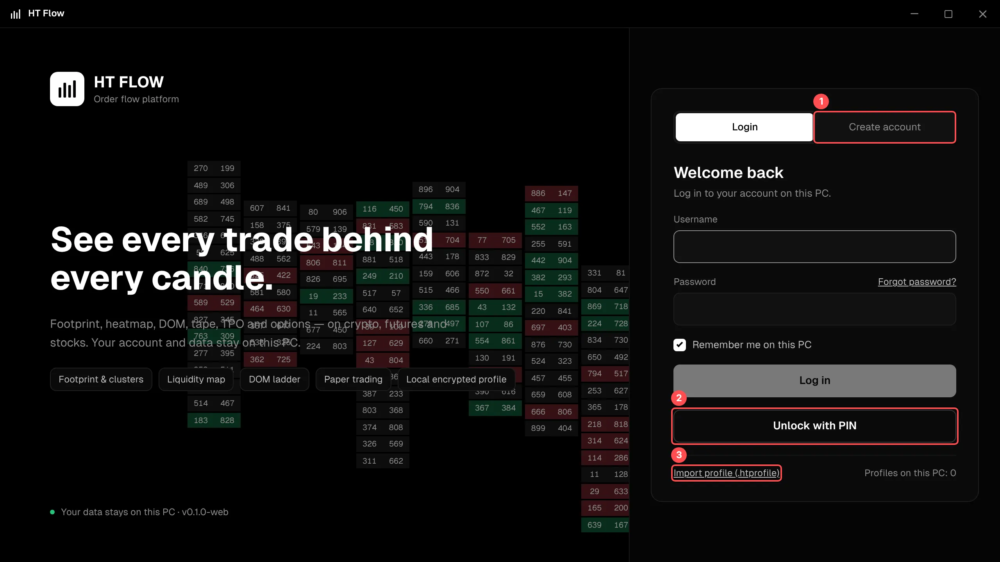
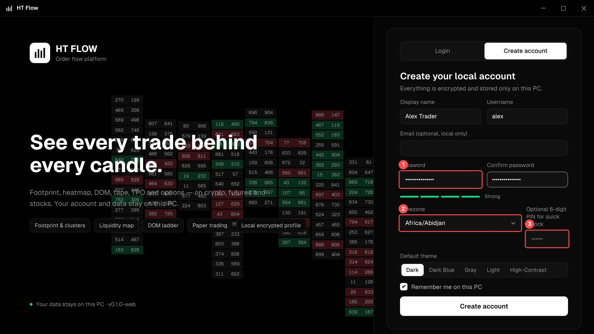
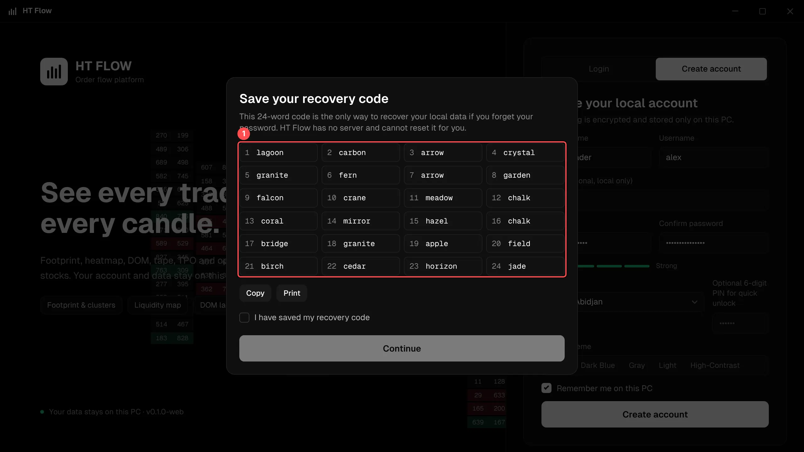
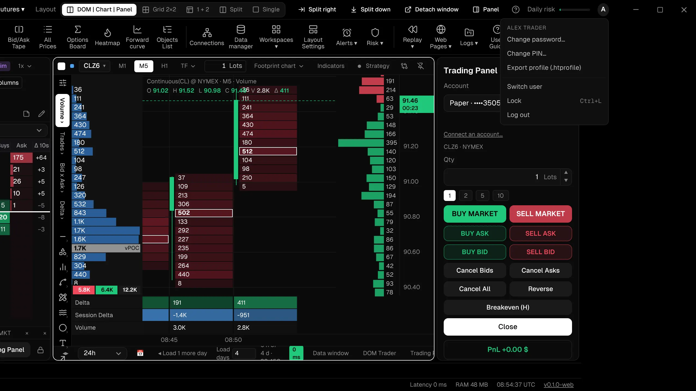
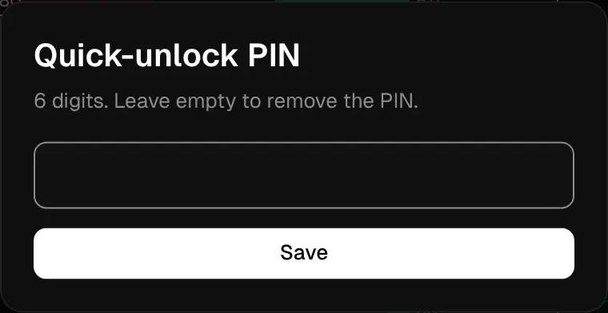
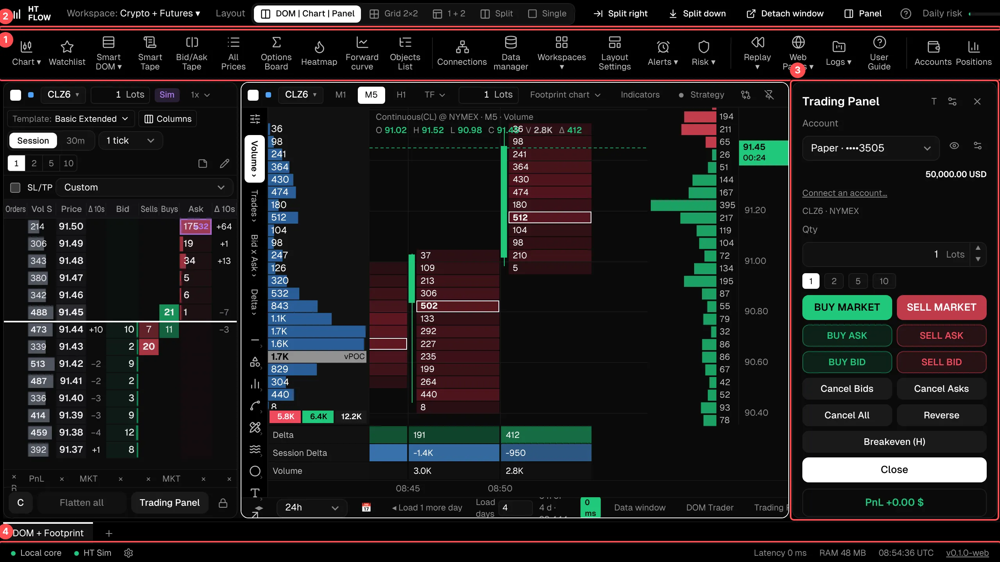

HT Flow is an order-flow trading workspace for Windows: footprint charts, a liquidity heatmap, a depth-of-market ladder, tape tools, replay, strategies and a paper-trading engine. Everything runs on your PC; there is no HT Flow server and no subscription.

## Install

1. Download `HT Flow_<version>_x64-setup.exe` from the latest GitHub Release (or the CI artifact `HTFlow-windows-x64`). An MSI and a portable zip are published next to it.
2. Run the installer. It installs for your user only, so no administrator rights are needed.
3. The installer is not code-signed yet. If Windows SmartScreen says "Windows protected your PC", click **More info**, then **Run anyway**.

> **Tip** Portable mode: put an empty file named `portable` next to `HT Flow.exe`. Your data then lives in a `data` folder beside the program instead of `%APPDATA%\HTFlow`.

HT Flow opens `.htprofile`, `.htworkspace`, `.htind` and `.httemplate` files when you double-click them.

## Create an account

> **Note** The HANAN TRADE logo appears on the lock screen only (login, unlock and the lock after inactivity). The rest of the application carries just the HT Flow name.

The first screen offers **Login** and **Create account**. Click **Create account** and fill in:

- **Display name** and **Username** (the username is what you type to log in).
- **Email** (optional). It is stored encrypted on this PC and never sent anywhere.
- **Password** and **Confirm password**: at least 10 characters. The strength meter under the field tells you how guessable it is.
- **Timezone** (used for the clock and as the default for tables) and a **Default theme**.
- **Optional 6-digit PIN** for quick unlock.
- **Remember me on this PC**, which keeps the data key in the Windows Credential Manager so you do not retype the password.

### Save the recovery code

After **Create account** HT Flow shows 24 recovery words. There is no server to reset your password, so this code is the only way back in if you forget it. Use **Copy** or **Print**, store it offline, tick **I have saved my recovery code** and press **Continue**.

> **Warning** Everything (settings, workspaces, credentials, journal) is encrypted with a key derived from your password. Without the password or the recovery code the data cannot be opened by anyone, including us.

## Log in, PIN and lock

- **Login** takes username and password. Failed attempts add an increasing delay.
- **Unlock with PIN** on the login screen accepts a username and the 6-digit PIN. After five wrong PINs the PIN is removed and you must use your password.
- **Forgot password?** asks for the username, the 24-word code and a new password.
- **Import profile (.htprofile)** restores an exported profile, for example on a new PC.
- The account menu (round avatar, top right) has **Change password**, **Change PIN**, **Export profile**, **Switch user**, **Lock** (`Ctrl+L`) and **Log out**.

HT Flow also locks itself after a period of inactivity (Settings → General → Security → Auto-lock after, 30 minutes by default).

## Your first workspace

After sign-in the dashboard opens with a ready workspace: a **DOM** on the left, a **footprint chart** in the middle and the **Trading Panel** on the right, fed by the built-in simulator (badge **Sim**). Nothing you do here uses real money.

1. **Title bar** with workspace menu, layout presets, split / detach buttons, help menu, risk meter and account menu.
2. **Ribbon**: one button for every window.
3. **Trading Panel**: paper account, quantity and order buttons.
4. **Status bar**: connection pills, latency, clock and version.

Try this in the first minute:

1. Press `Ctrl+K` and type `grid`; pick **Layout: Grid 2×2**.
2. Press `Alt+D` on the chart to switch the footprint to Delta mode.
3. Press `F1` to open this guide at any time, or `Shift+F1` for help on the window you are working in.

## Guided tour

A short spotlight tour of the ribbon, chart, DOM, Trading Panel and status bar runs once on first start. Run it again from the Help menu or with the command **Start guided tour**.

Next: [Interface tour](02-interface-tour.md).
