## Title bar

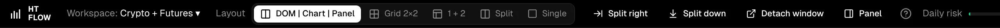

From left to right: the **workspace menu** (`Workspace: <name> ▾`: save, load, import, export), the **Layout** presets (DOM | Chart | Panel, Grid 2×2, 1 + 2, Split, Single), **Split right**, **Split down**, **Detach window**, the **Panel** toggle for the Trading Panel, the **Help** menu (?), the **daily risk meter**, and the **account menu**. With the Single preset, a **Main chart** group lets you switch the template (Candles + VP, Footprint, Liquidity Map, Order Flow).

## Ribbon

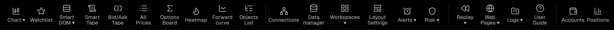

The ribbon has one button per window, grouped as Analysis, Platform, Social / Tools, Tables, Market Analytics and Info. Buttons with a ▾ open a menu (for example Chart lists templates, Alerts lists actions).

- Right-click a button to **Hide** it or choose **Customize ribbon…** to show, hide and reorder buttons (drag or keyboard). The layout is saved per user.
- The command **Ribbon: icons only** or Settings → Appearance → Ribbon makes it compact.
- With the ribbon focused use ← / → / Home / End to move and Enter to open.

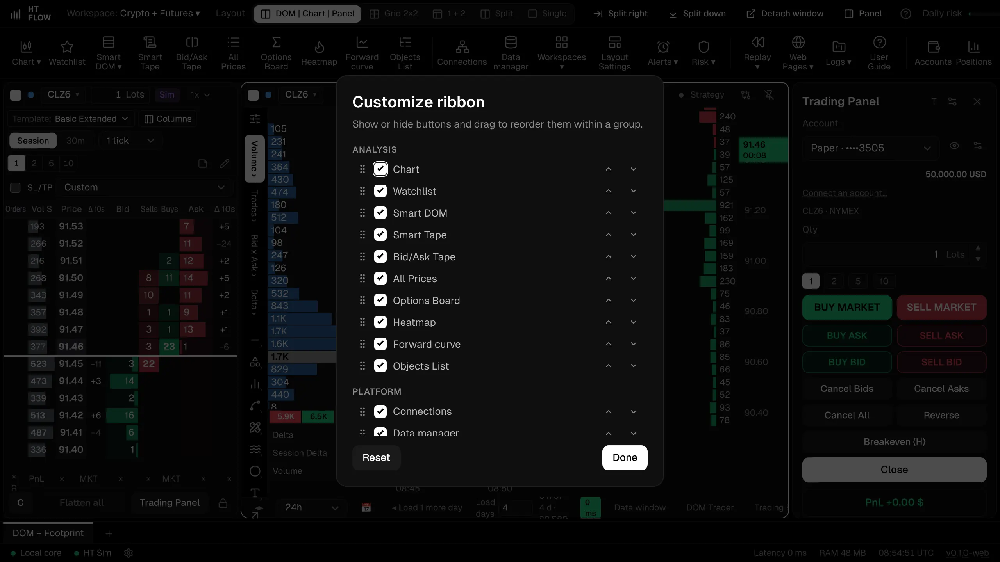

## Status bar

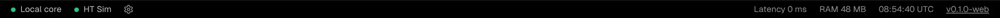

**Local core** (all data stays on this PC), one pill per connection (green = live, amber = delayed, red = error; click to open Connections), the cog for Connections, then **latency**, **RAM**, the **clock** in your application time zone and the **version**. Amber and red thresholds are set in Settings → Data delays.

## Command palette

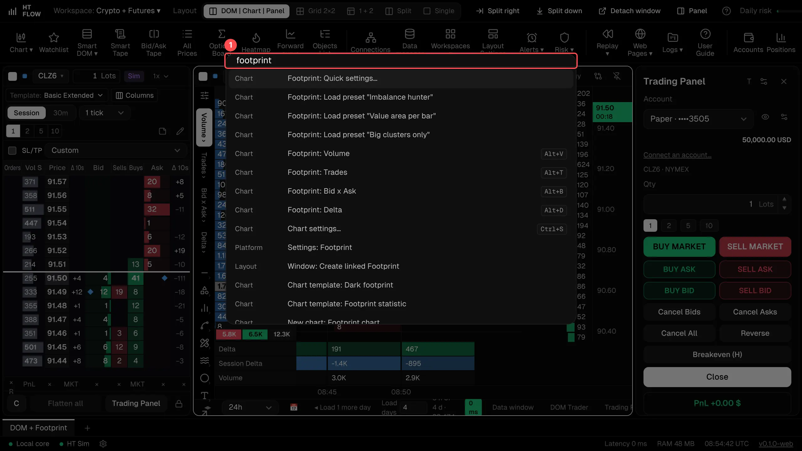

`Ctrl+K` opens the palette. Type to search **every command** (windows, chart actions, layouts, settings sections, symbols, indicators). Enter runs the highlighted row; Esc closes. Results are grouped; indicators and settings appear under their own headers. Because every action is a command, anything you can click can also be bound to a key (Settings → Hot keys) and found here. See [Keyboard shortcuts](16-keyboard-shortcuts.md).

## Windows and panels

Every tool is a window in a docking area:

- Drag a window's header onto the edges or centre of another window to **dock** it as a split or a tab.
- Drag the splitters between windows to resize.
- **Split right / Split down** duplicates the active window next to it.
- **Detach window** makes it float above the dock; the window menu (⋯) can **Float / Dock** it again, **Clone** it, or create a **linked** chart, DOM, tape, heatmap, footprint or options window.
- **Maximize** (header) fills the dock area; click again to restore.

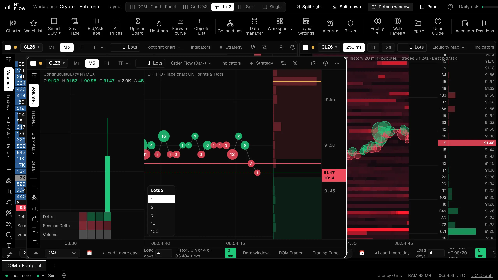

> **Note** Floating windows stay inside the HT Flow window. A true pop-out to another OS window is not available yet; multi-monitor restore keeps windows on the monitor that held them.

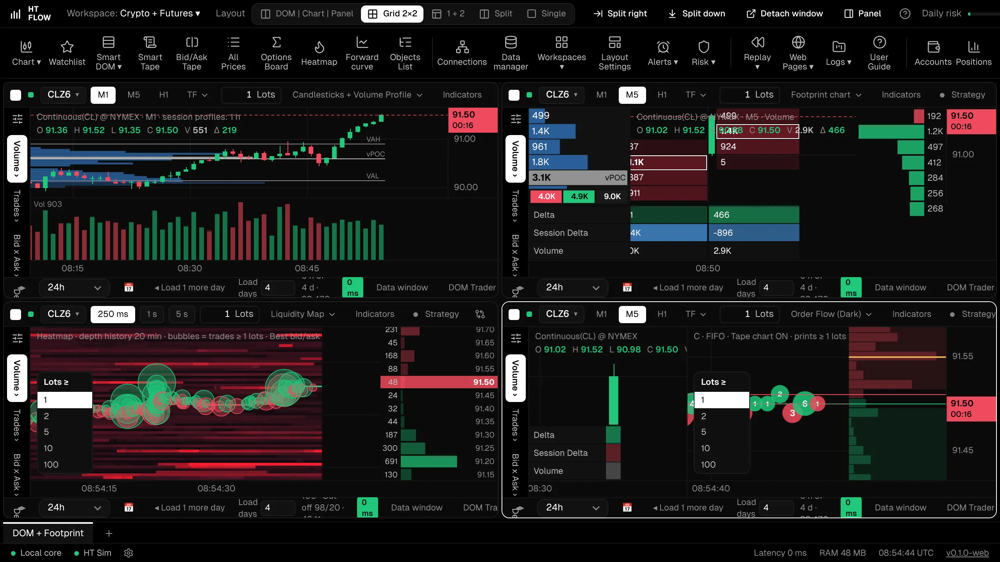

Each window header has a **?** button, "Help for this panel", that opens the guide at the matching topic.

### Link groups

The coloured dot at the left of a window header is its **link group** (none, red, green, blue, yellow, purple). Changing the instrument in one window changes every window with the same colour. **Pin** (chart menu) keeps a chart's instrument when its group changes.

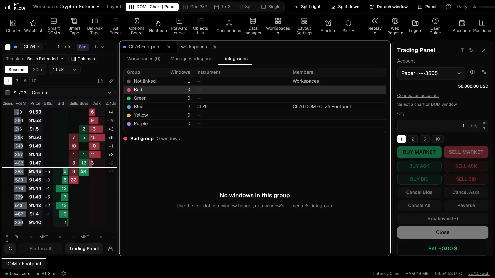

## Workspaces and layouts

A **workspace** is the set of windows, their arrangement and their settings. It autosaves on change and every minute, and is restored at start (or choose another start-up workspace in Settings → General).

- **Layout tabs** at the bottom: each tab is a saved layout. **+** adds one, double-click or `F2` renames, Delete closes, ← / → move between tabs.
- **Workspaces manager** (ribbon → Workspaces → Workspaces manager…): save, save as, rename, load, duplicate, delete, export and import `.htworkspace` files. Eight starter workspaces are included: Scalping NQ, Crypto Flow, Futures, Multi-Chart 2×2, Heatmap + DOM, Options Desk, Analysis and Replay practice.
- **Layout Settings** window: snapping, grid size, gaps, lock layout, where new windows open, header style and tabs position.

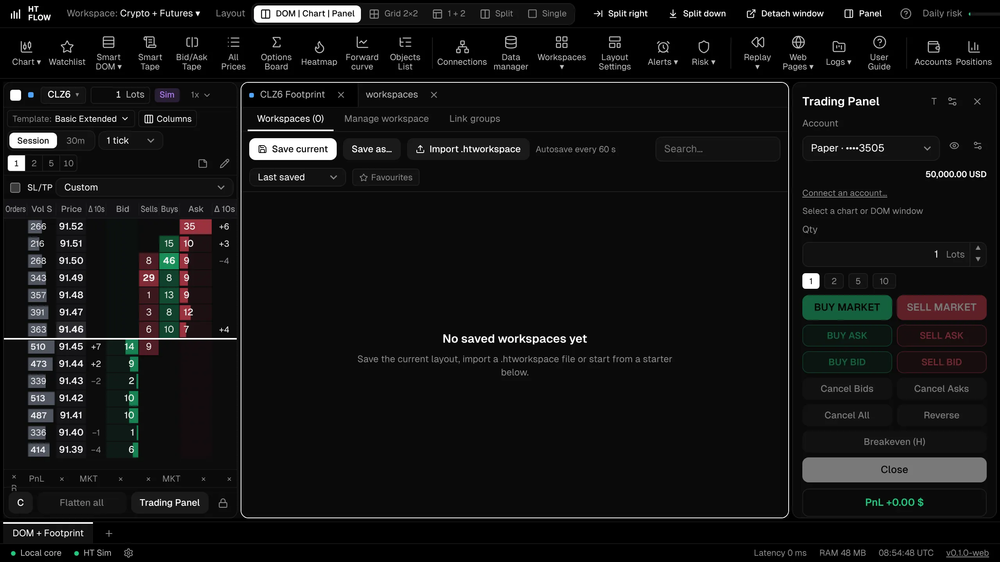

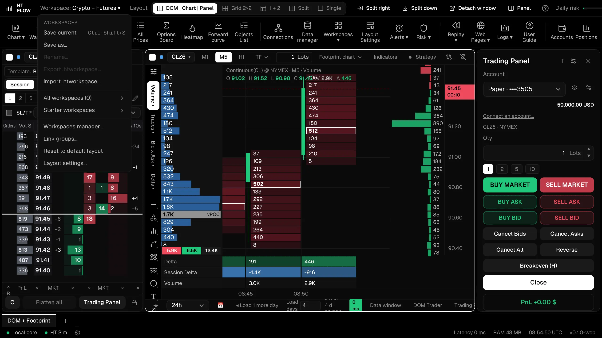

## Themes and appearance

Settings → Appearance has five themes (Dark, Dark Blue, Gray, Light, High-Contrast), a 29-token colour editor, UI scale and font size, and theme JSON import / export. Chart colours have their own presets (chart template menu and Settings → Chart).

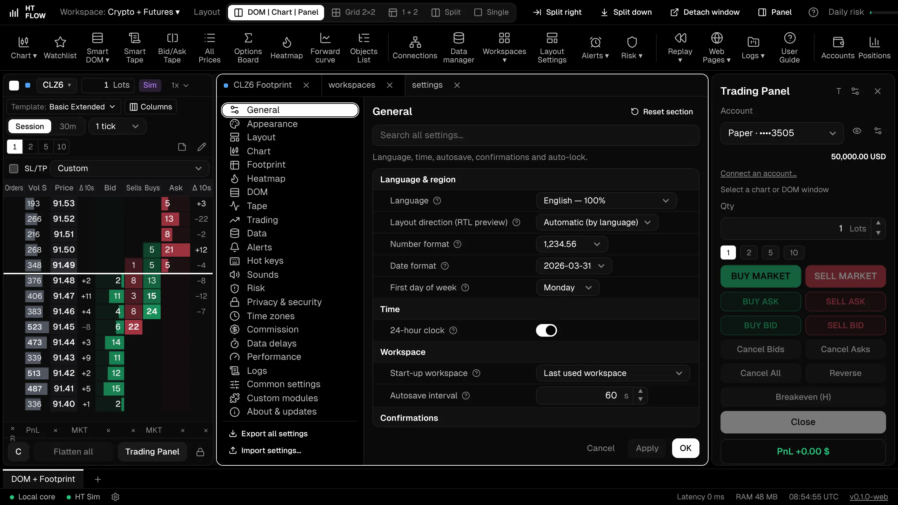

## The Help menu

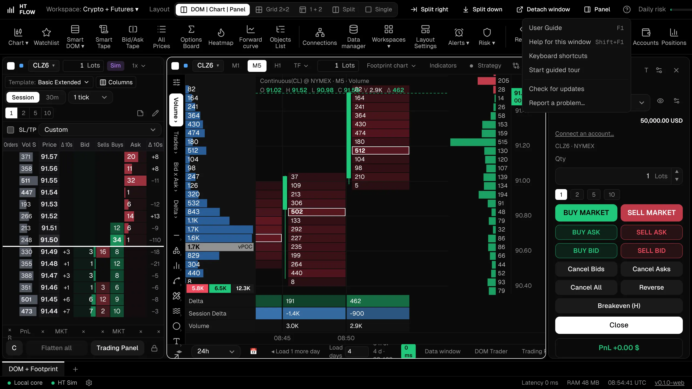

The **?** in the title bar opens the **User Guide** (`F1`), help for the current window (`Shift+F1`), the keyboard shortcut list, the guided tour, update check and **Report a problem…**.
