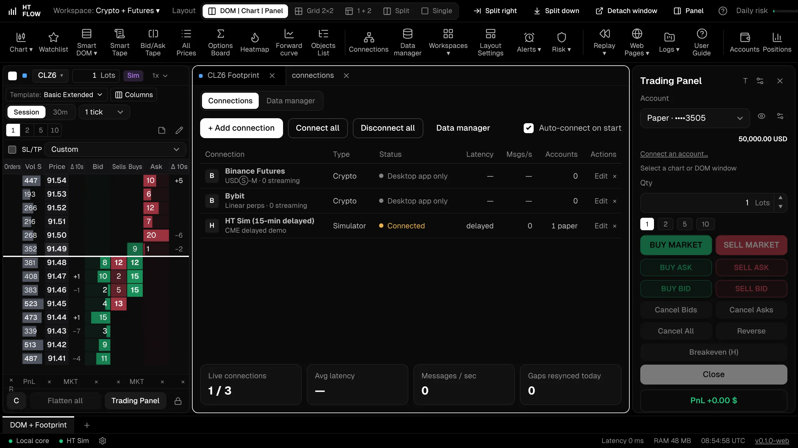
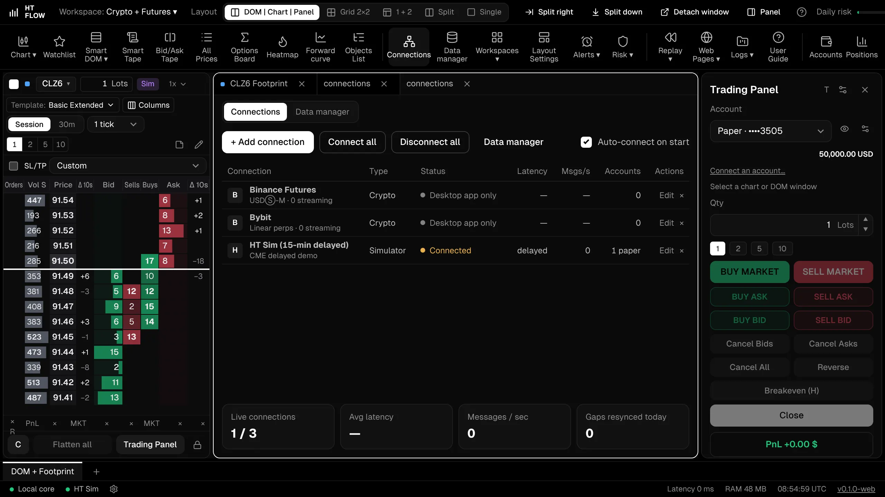
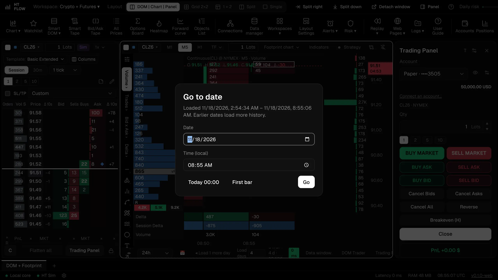
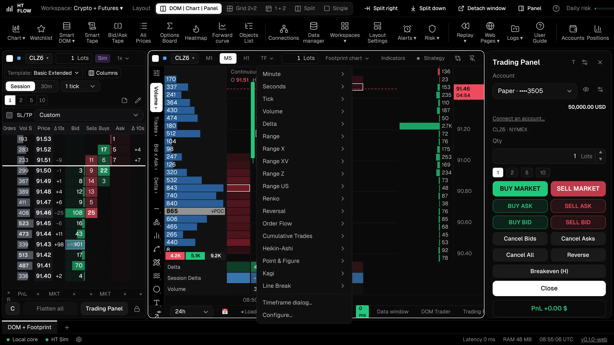

## Data sources at a glance

| Source                                                                                                                      | What it gives you                                                                                      | Needs                                    |
| --------------------------------------------------------------------------------------------------------------------------- | ------------------------------------------------------------------------------------------------------ | ---------------------------------------- |
| **HT Sim** (futures: CLZ6, GCZ6, ESZ6, NQZ6)                                                                                | Seeded, realistic trades and depth, works offline, paper account                                       | Nothing                                  |
| **Crypto Sim** (BTCUSDT)                                                                                                    | Same for crypto                                                                                        | Nothing                                  |
| **Crypto venues** (Binance spot / USDⓈ-M / COIN-M, Bybit, OKX, Bitget, Bitfinex, Kraken Futures, Deribit, Phemex, Whitebit) | Live public trades and order book, funding, open interest, liquidations where the venue publishes them | Internet. No API key for market data     |
| **CSV import**                                                                                                              | Your own trades or OHLCV bars as an instrument                                                         | A file                                   |
| **Custom WebSocket**                                                                                                        | Any JSON feed you map to trades / depth                                                                | A `ws://` or `wss://` URL                |
| **Futures and stock brokers** (Rithmic, CQG, Tradovate, Interactive Brokers, dxFeed, …)                                     | Listed so you can see the roadmap                                                                      | Vendor SDK or licence; not connected yet |

> **Note** Live exchange connections work in the desktop app. The browser preview cannot reach exchange APIs (CORS), so it shows the simulator only. Trading is always on the paper engine.

## Connections window

Open it from the ribbon (**Connections**) or by clicking a pill in the status bar.

- **+ Add connection** starts a wizard: pick a provider, choose the market, optionally enter a test symbol, **Test**, then **Save**.
- **Connect all / Disconnect all** and **Auto-connect on start**.
- Each row shows status, latency, messages per second and accounts; **Edit** changes it, ✕ removes it.
- The tiles at the bottom show live connections, average latency, messages per second and gaps re-synced today.
- The **Data manager** tab shows what is stored locally (see [Data manager](14-data-manager.md)).

Credentials you enter (for example a Telegram token or a venue key for trading) go into your encrypted vault, never into plain files or logs.

## Symbols and the instrument picker

Click the instrument name in a window header (for example `CLZ6 ▾`) to open the picker:

- A **group tree** (futures, crypto venues, ...), plus **All / Favourites / Recent**.
- **Typo-tolerant search** across thousands of symbols.
- A star adds a favourite; the **Has live feed** filter hides rows without a feed. The status column reads Live, Sim, Delayed, Replay or No feed; rows with no feed offer Connections.
- Drag a symbol from the picker onto a window to change its instrument, or hold `Ctrl` while dropping (or drop on empty dock space) for a new chart window.
- The command **Refresh symbol list (all exchanges)** re-reads the venues' exchange-info endpoints.

Futures contracts follow the catalog's roll rules; the front month is chosen automatically.

## History

When you open a chart on a live venue, HT Flow first reads what it already has in the **local tick store**, downloads only the missing gaps from the venue's public REST API, then switches to the live stream with no gap or duplicate at the seam.

- **◂ Load 1 more day** and **Load days** (bottom bar) fetch older history; scrolling left loads more automatically.
- `Ctrl+G` (**Go to date**) jumps to a date and loads it.
- **Reload all historical data** re-downloads the visible range.
- Older than the last day or so, venues serve candles instead of trades. Binance candles carry the real taker split; on other venues the buy / sell split of old bars is estimated. The tick recorder stores your live data so later sessions have exact trades.

## Timeframes and bar types

The header chips (M1, M5, H1 …) switch timeframe; **TF** opens the full dialog with rows for each bar type: Time, Tick, Volume, Delta, Range, Range X / XV / Z / US, Renko, Reversal, Order Flow, Cumulative Trades, Heikin-Ashi, Point & Figure, Kagi and Line Break. **Configure** adds or removes chips and pins favourites to the header. Chips can be greyed out when the feed cannot provide that bar type.

## Trading sessions

The bottom bar session selector switches **24H**, **ETH**, **RTH** or a **Custom** session (open / close / time zone / days) according to the exchange rules in the catalog.
