## Opening and navigating a chart

Open a chart from the ribbon (**Chart ▾** lists templates), with `Ctrl+K` → `New chart: …`, or by splitting an existing window. The header shows the link dot, instrument, timeframe chips, lots, the template menu, **Indicators**, strategy controls, a feed badge (Live / Sim / Replay), a snapshot camera (copies a PNG), maximize, settings and close.

| Action           | Mouse / key                                                           |
| ---------------- | --------------------------------------------------------------------- |
| Zoom time        | Wheel                                                                 |
| Zoom price       | `Ctrl` + wheel, or drag the price axis                                |
| Scroll           | `Shift` + wheel, or drag                                              |
| Move vertically  | `Shift` + drag                                                        |
| Auto-scale price | Double-click the price axis                                           |
| Go to latest     | Double-click the time axis, or `Ctrl+R` (also resets scale)           |
| Full screen      | `Ctrl` + double-click on the chart                                    |
| Right-click      | Chart menu (orders, alerts, mode, scale, templates, export, settings) |

Mouse modes (right-click → Mouse): **Pointer, Crosshair, Zoom** (drag a box), **Scroll, ZoomXY**. Crosshair sync can be off, per link group, or global across all windows.

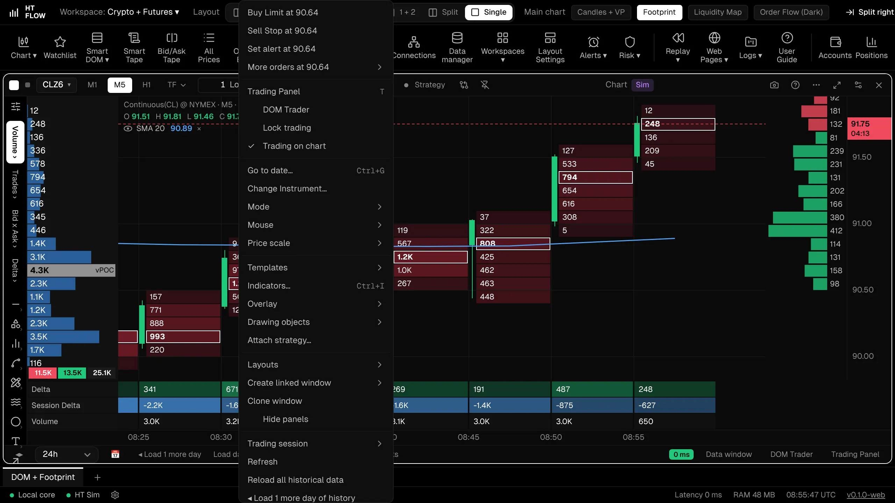

## Chart types

Use the template menu in the header (or `New chart: …` commands). All types read the same data, so switching keeps your zoom.

| Template                            | What you see                                                                      |
| ----------------------------------- | --------------------------------------------------------------------------------- |
| **Candlesticks + Volume Profile**   | Candles with period volume profiles, vPOC, value area high and low                |
| **Footprint chart**                 | Bid x ask volume at every price inside each bar                                   |
| **Liquidity Map**                   | Resting order-book depth over time with trade bubbles                             |
| **Order Flow (Dark / Light)**       | Candles and heat rows on the left, a tape chart with bubbles on the right         |
| **Imbalance Chart**                 | Footprint tuned to diagonal and stacked imbalances                                |
| **TPO Chart**                       | Market-profile letters or blocks, value area, POC, initial balance, single prints |
| **On-Chart Liquidity Map**          | Heat texture behind the candles                                                   |
| **Multi-timeframe Chart**           | Several timeframes as boxes, side by side or stacked                              |
| **Volume Histogram, Delta Profile** | Per-bar histograms of volume or delta at price                                    |
| **COT Chart**                       | Commitments of Traders (bundled sample data, labelled)                            |

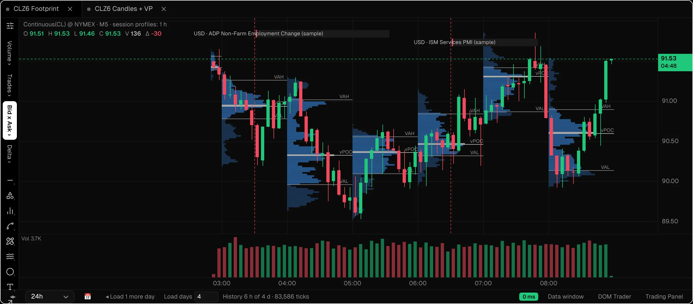

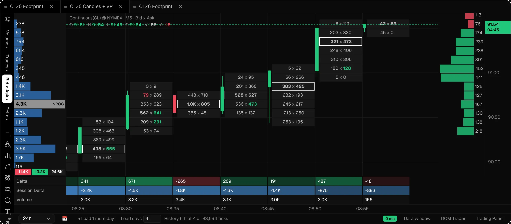

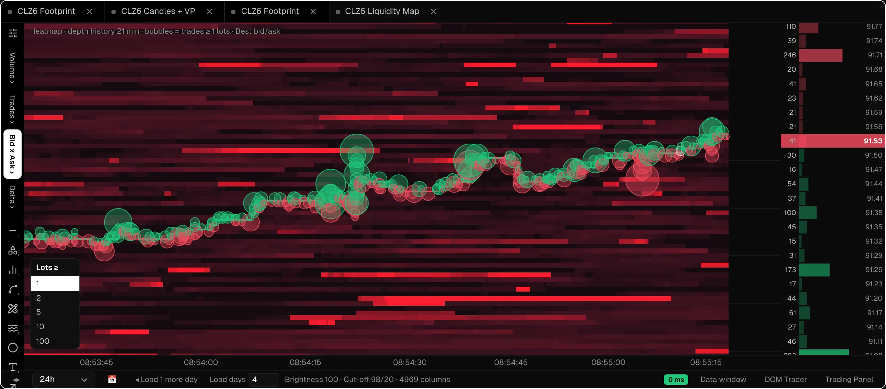

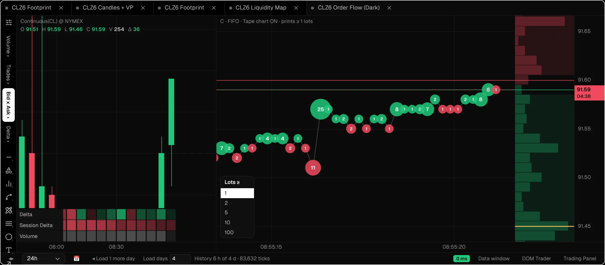

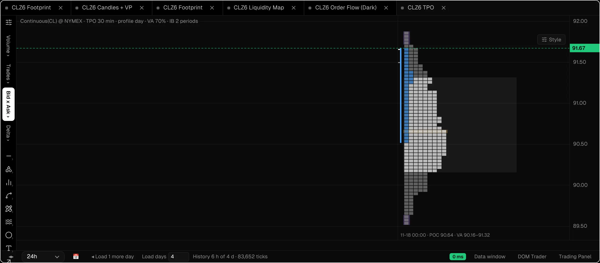

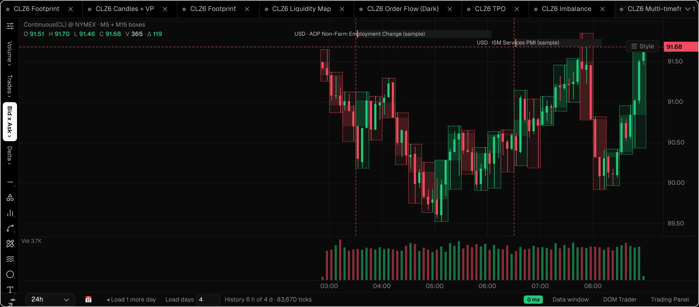

Right-click → **Mode** (or `Shift+C / B / T / L / M / H`) switches between Candles, Bars, Transparent candles, Line, Area and Hidden. Price scale can be linear, logarithmic, percent, indexed to 100 or inverted. The bar type itself (Renko, Range, Heikin-Ashi, Point & Figure, Kagi …) is chosen in the timeframe dialog; see [Connecting data](03-connecting-data.md#timeframes-and-bar-types).

### Templates and snapshots

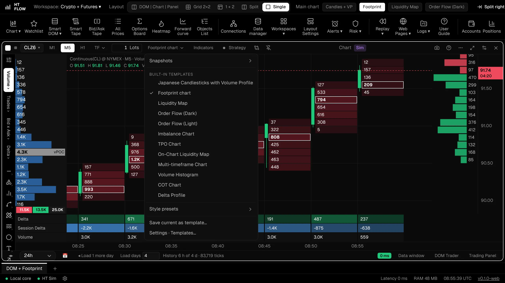

- **Built-in templates** appear in the menu; style presets (White, Light, Dark, Black, Dark footprint, Footprint statistic, Imbalance, MarketResearch, MultiTimeFrame) restyle the chart.
- **Save as template…** stores your own `.httemplate` (indicators, drawings settings, style). Templates can be renamed, duplicated, overwritten, exported, imported, favourited and set as the default for an instrument class.
- **Take snapshot** saves the chart state (listed under Snapshots in the same menu) so you can return to it.

## Indicators

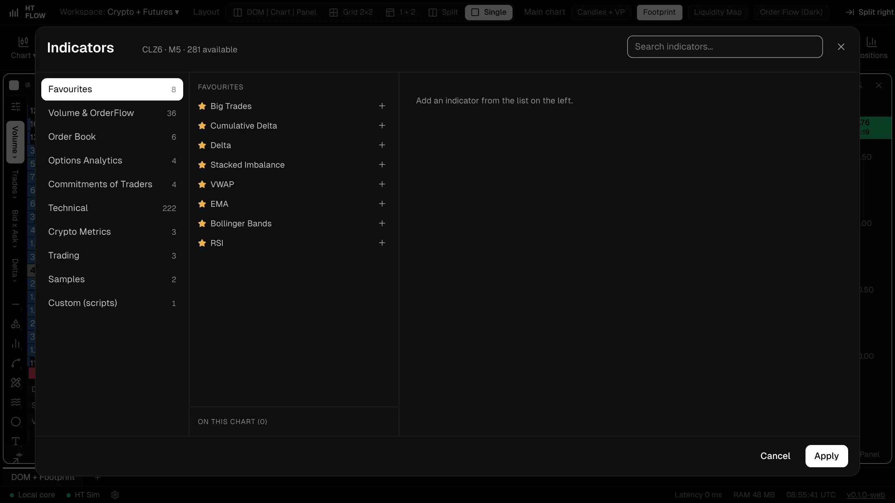

Press `Ctrl+I` or click **Indicators** in the header. 281 indicators are catalogued in categories (Volume & OrderFlow, Order Book, Technical, Crypto Metrics …; see `docs/INDICATORS.md`). Search, star favourites, press **+** to add, then tune each one in its tabs **Inputs / Style / Visibility / Advanced** with a live preview (Cancel reverts). The on-chart list lets you hide, reorder, duplicate and remove.

- Indicators can live on the price pane, in their own sub-pane, or share a pane. Drag a legend title to move it. Sub-panes can be resized or maximised.
- The **legend** on the chart shows values at the cursor with eye, settings and remove buttons.
- **Advanced → timeframe override** computes an indicator on a higher timeframe; an indicator can also use another symbol as its data source.
- **Alerts tab**: fire a toast, sound or activity-log entry when an output crosses a level or another output.
- The **Script Editor** (command `Indicators: Script Editor`) writes your own indicators in HT Script, a small sandboxed language, with a personal library and `.htind` export / import.

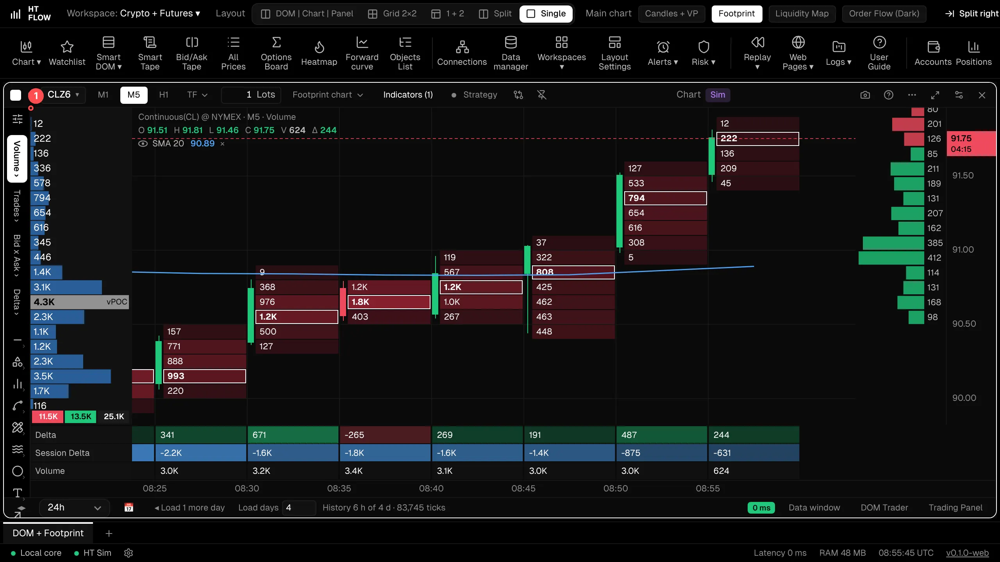

## Drawing tools

The side tools on the left edge hold 67 drawing tools in groups: Lines, Shapes, Volume Analysis, Fibonacci, Measurement, Elliott, Markers, Text, Positions, Gann & Pitchfork. Pick a tool, click or drag on the chart. Drawings are saved with the window and follow it across layout tabs.

| Key                 | Tool                               |
| ------------------- | ---------------------------------- |
| `F2`                | Trend line                         |
| `F6` / `F7`         | Horizontal / vertical line         |
| `F12` / `F11`       | Rectangle / triangle               |
| `F8`                | Fibonacci retracements             |
| `F3` / `Ctrl+F3`    | Volume profile & TPO / fixed range |
| `F4`                | Anchored VWAP                      |
| `F9`                | Ruler                              |
| `M`                 | Magnifier                          |
| `Del`               | Delete selected                    |
| `Ctrl+Z` / `Ctrl+Y` | Undo / redo                        |
| `Ctrl+A`            | Select all drawings                |

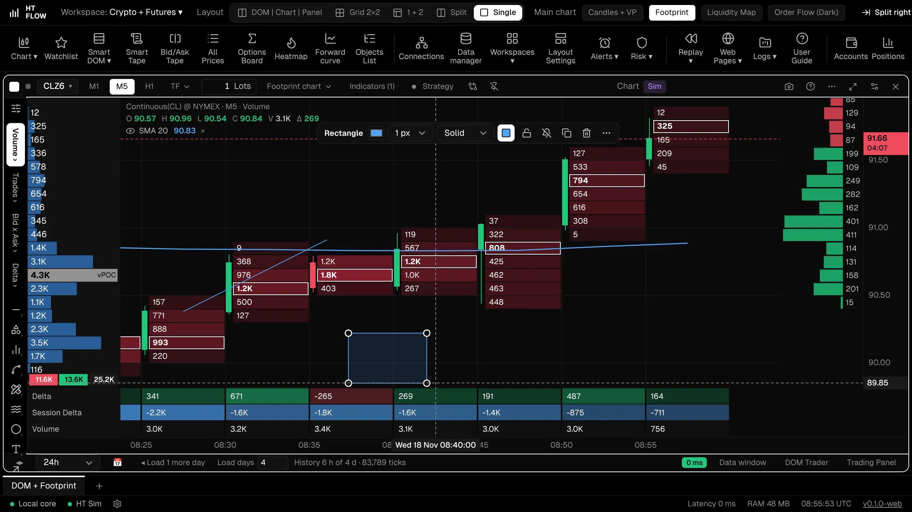

- Drag anchors to edit; **magnet** snaps to prices (off / weak / strong). Shift+click or `Ctrl`+drag a box selects several drawings for group move, delete or style.
- The style bar sets colour, width, dash, fill, text and per-timeframe visibility. Lines, rays, channels and rectangles can have a **price alert** (bell icon): cross, enter or exit.
- **Objects List** (ribbon) lists all drawings with lock, hide, clone and delete.
- Drawings can sync across linked charts.

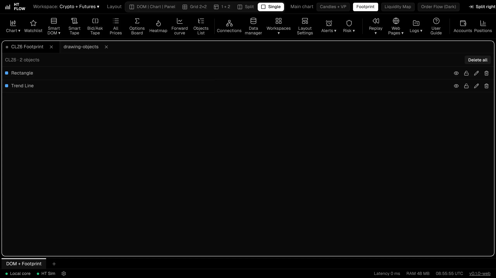

## Chart settings

`Ctrl+S` opens per-chart settings with Visual, Footprint, Trading and Templates tabs. Changes apply live; Cancel reverts; settings export to JSON. Global defaults live in Settings → Chart and Footprint.

## Linked windows and multiple charts

- **Link groups**: same colour, same instrument. Combine with global crosshair sync to read several timeframes at once.
- Window menu (⋯) → **Create linked window** opens a chart, DOM, tape, heatmap, footprint or options window already linked; **Clone** copies the window with its settings.
- **Overlay / compare** (right-click → Overlay) adds another instrument normalised to percent.
- **Export** (right-click → Export): PNG, bars CSV, clusters CSV, bars JSON or the template as JSON.

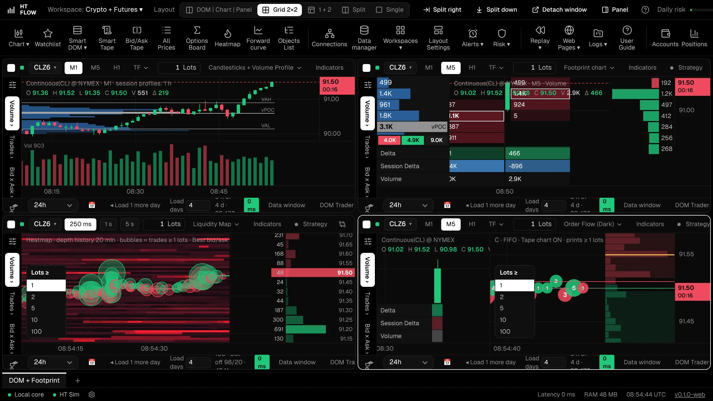
