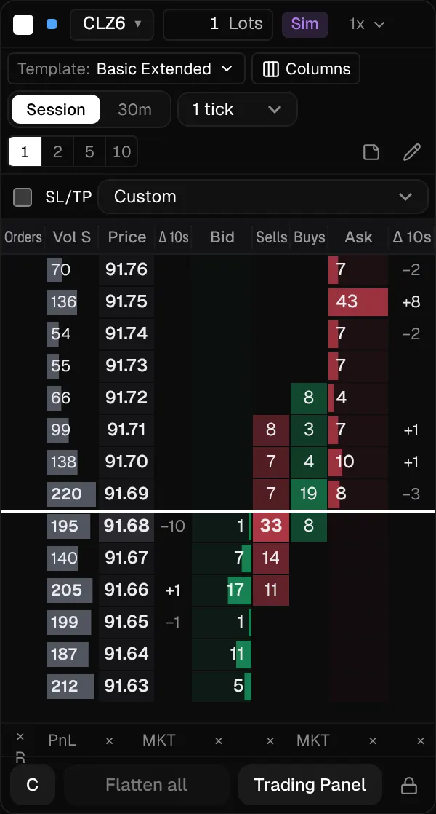
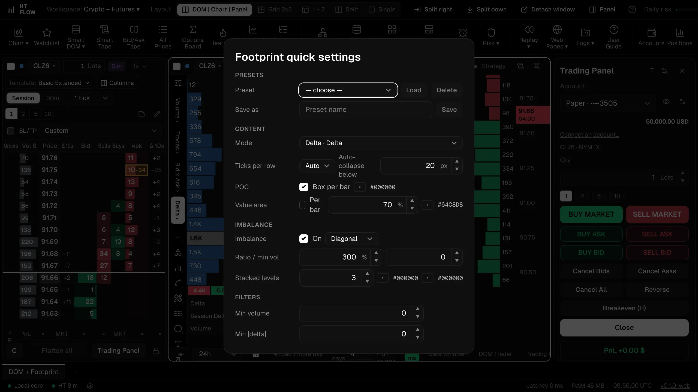
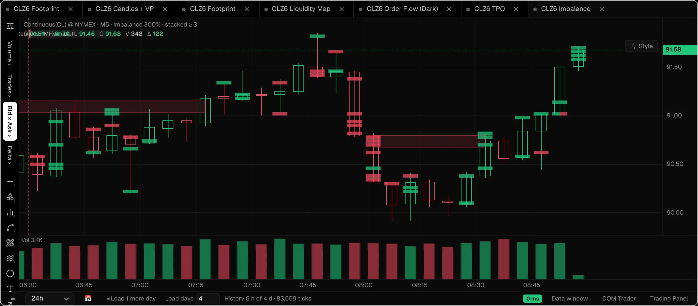
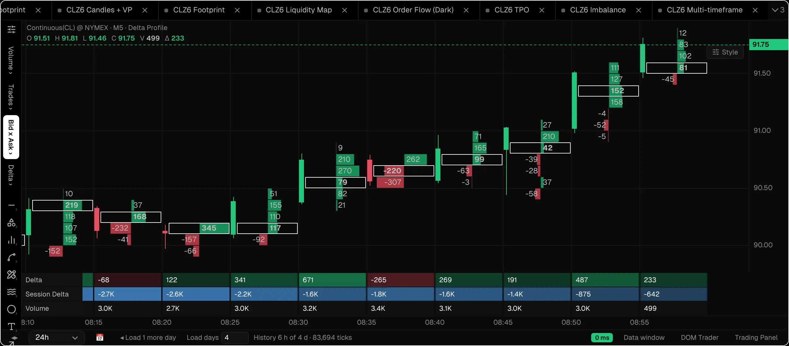
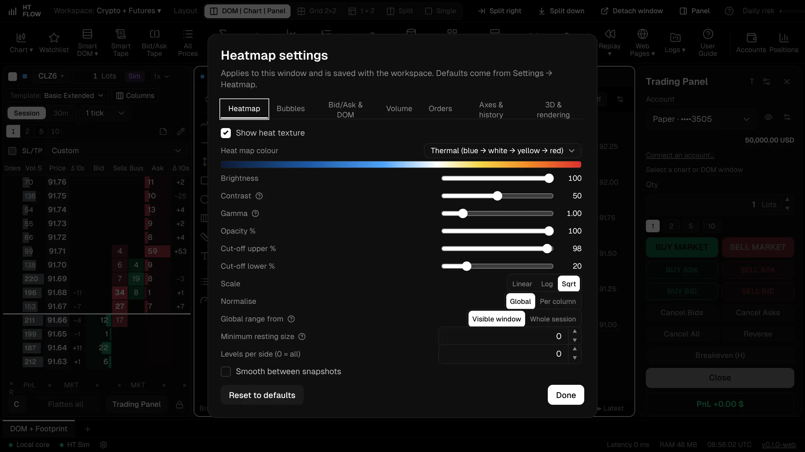
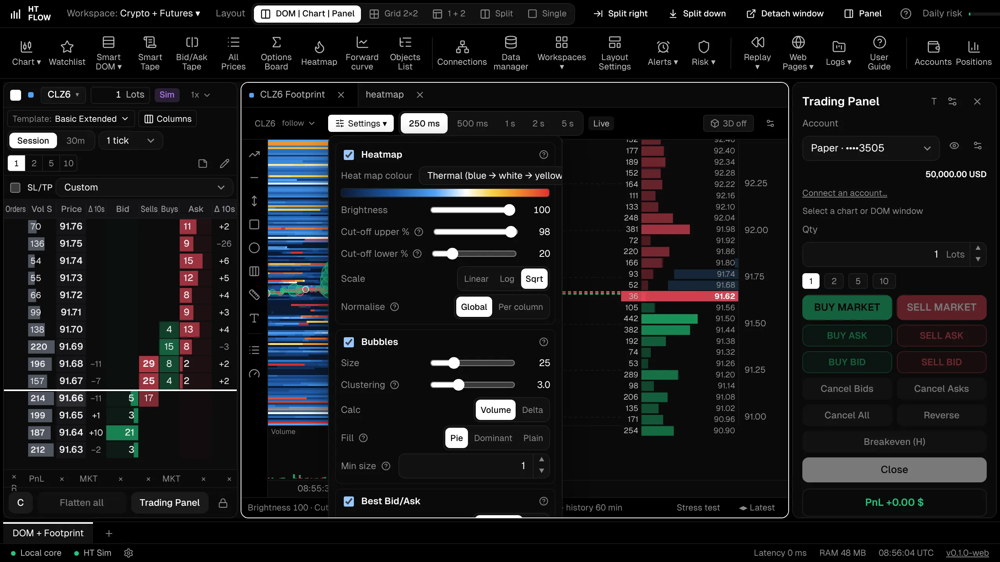
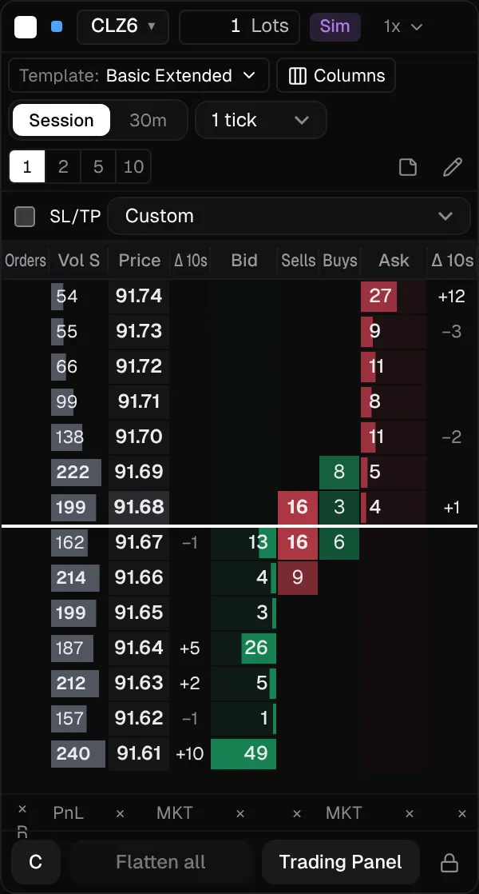
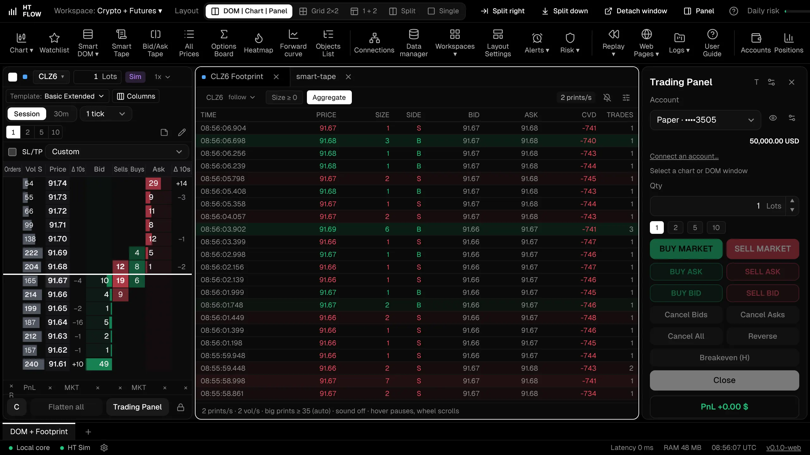
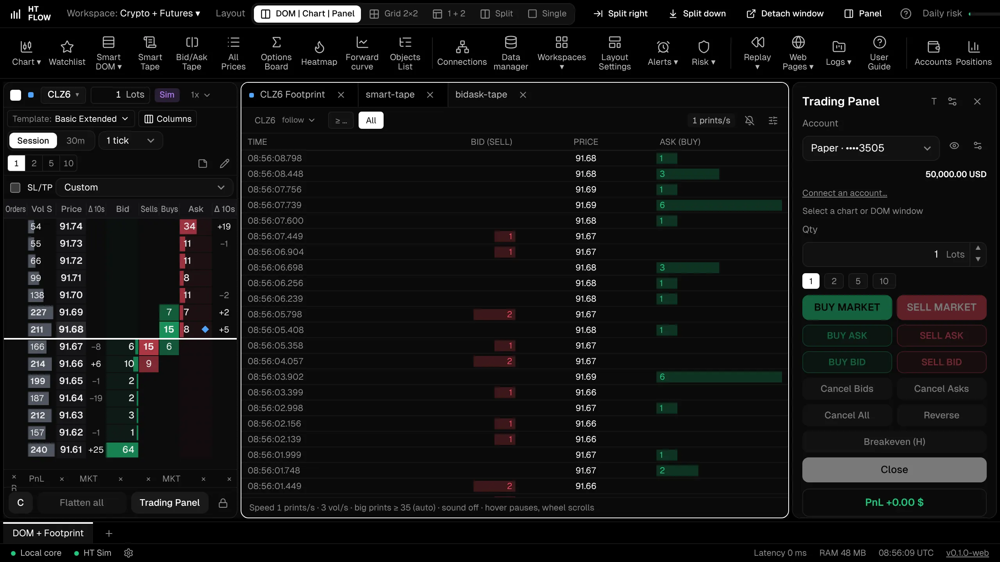
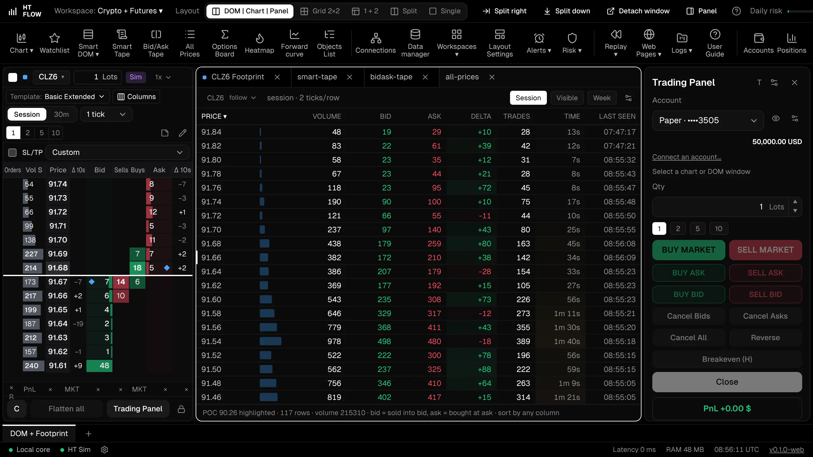

Order-flow tools show **who traded at which price** (aggressor side) and **what was resting in the book**. HT Flow builds bars from individual trades, so each bar knows the volume bought at the ask and sold at the bid for every price.

## Footprint

Open **Footprint chart** (ribbon → Chart ▾, or `New chart: Footprint chart`). Each bar is split into price rows (clusters).

**Cell content** (21 modes): switch with the vertical tabs on the left side tools (Volume ›, Trades ›, Bid x Ask ›, Delta ›) or the keys `Alt+V` (Volume), `Alt+T` (Trades), `Alt+B` (Bid x Ask), `Alt+D` (Delta). More modes include Volume x Trade and Volume x Delta; styles include numbers, histogram, ladder and bid/ask or delta profile.

What the marks mean:

- **Bid x Ask**: sells at the bid on the left, buys at the ask on the right.
- **Delta** = ask volume − bid volume. Green is buyers aggressing, red is sellers.
- **POC box**: the price with the most volume in the bar. The **value area** (default 70 %) is shaded.
- **Imbalance**: a cell is highlighted when ask volume at a price exceeds bid volume one row below by the ratio (default 300 %) and the minimum volume. **Stacked imbalances** of N consecutive levels are drawn as zones extended to the right.
- **Statistics rows** under the chart: Delta, Session Delta, Volume (plus Trades, Delta %, Max / Min delta).
- **Absorption markers** flag heavy volume that did not move price (Settings → Footprint).

**Quick settings**: the slider button on the side tools (or `Footprint: Quick settings…`) sets mode, ticks per row (auto, 1, 2, 4, 5, 10), auto-collapse width, POC, value area, imbalance ratio and colours, filters (minimum volume / delta) and presets (Imbalance hunter, Value area per bar, Big clusters only; you can save your own).

> **Tip** Zoomed out below about 20 px per bar, the footprint collapses to candles automatically (configurable) so large histories stay fast.

## Volume profile

- **Candlesticks + Volume Profile** draws a profile for each period with vPOC, VAH and VAL. The Footprint chart also shows the visible-range profile on the left and the previous session profile.
- Draw **Volume Profile & TPO** (`F3`) or **Fixed range** (`Ctrl+F3`) on any range, and **Anchored VWAP** (`F4`).
- **TPO Chart** is a market profile with letters or blocks, value area, POC, initial balance and single prints.
- **Delta Profile** and **Volume Histogram** show delta or volume by price per bar.

## Heatmap / liquidity map

The heatmap draws resting liquidity from the order book over time: one pixel per time column and price row, brighter = more size. Use the **Liquidity Map** chart template, the standalone **Heatmap** window (ribbon), or **On-Chart Liquidity Map** behind candles.

- **Trade bubbles** show executed volume (plain, pie of buy / sell, or dominant side). Filter with **Lots ≥**.
- Best bid / ask lines, a **DOM column** on the right, volume bars (by volume or delta).
- **Column size** 250 ms to 5 s; colour gradients (Thermal, Classic, Ruby, Monochrome, Ocean, Blue to red, Viridis), contrast, upper / lower percentile cut-off, linear / log / sqrt scale, normalisation per column or global.
- **Large order outlines**, **order lifetime** colours, and **iceberg** and **spoof** detection with adjustable thresholds.
- **3D mode** renders the book as a surface (falls back to a 2D isometric view without WebGL).
- Quick settings popover, full settings dialog, snapshot (PNG) and reset view are all commands (`Heatmap: …`). The left toolbar has trend line, horizontal / vertical line, rectangle, ellipse, channel, measure and text.

## Smart DOM

The DOM is a price ladder with the book and your orders. Open it from the ribbon (**Smart DOM ▾** has 13 templates, from Basic to Prop DOM with a risk strip) or use the DOM Trader docked beside any chart (chart bottom bar).

- Columns include Orders / P&L, volume at price (session or rolling), Price, change, Bid, Sells, Buys, Ask, Σ bid / Σ ask, delta, last size, value area / POC, notes and stop / iceberg markers. Toggle, reorder, resize and colour them from the **Columns** menu or the template designer (`Smart DOM: template designer…`).
- **Centering**: auto-centre follows price; the wheel scrolls; `C` or double-click re-centres; `PageUp` / `PageDown` scroll.
- **Grouping**: 1, 2, 5 or 10 ticks per row.
- **One-click trading** is described in [Trading](06-trading.md#dom-and-chart-trading).

## Time and sales (Smart Tape)

- **Smart Tape** lists prints with size-bucket colours. Prints at the same timestamp (or within a time window) can be aggregated into one line with VWAP, fill count and cumulative delta. Filters on size, side and time; **pause on hover**; wheel scrolls back; prints per second and volume per second are shown.
- **Bid/Ask Tape** splits sells (left), price and buys (right) with size chips and a speed meter.
- **All Prices** is a price-by-price table of session volume with delta, time at price, POC and a volume bar; sort by any column, group rows, and choose Session / Visible / Week.

Each tape follows the active chart or DOM, or you can pin an instrument.

## Big trades

Large prints are highlighted in several places, all driven by thresholds you set:

- **Smart Tape**: _Big-trade threshold_ highlights the row and can beep (Settings → Tape).
- **Heatmap**: bubbles scale with size; **Lots ≥** hides small ones.
- **DOM**: _Big-lot threshold_ (Settings → DOM) highlights large resting orders.
- **Alerts**: a _big trade_ condition notifies you (see [Alerts](08-alerts.md)).
- The **Big Trades** indicator (Indicators → Favourites) marks them on the chart.
