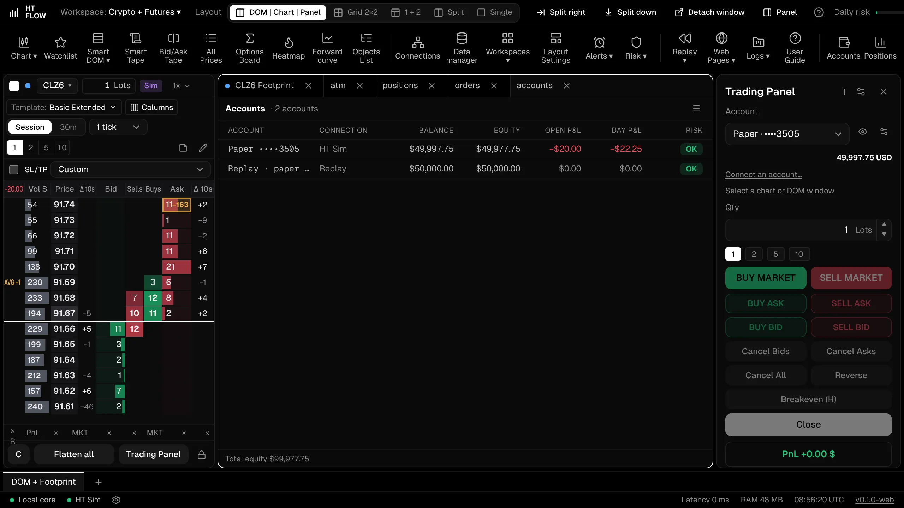
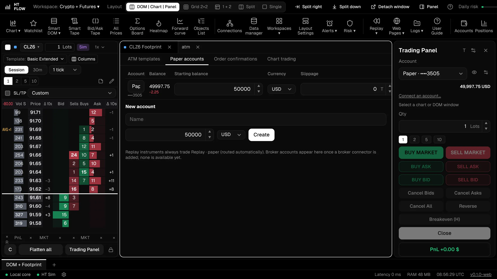
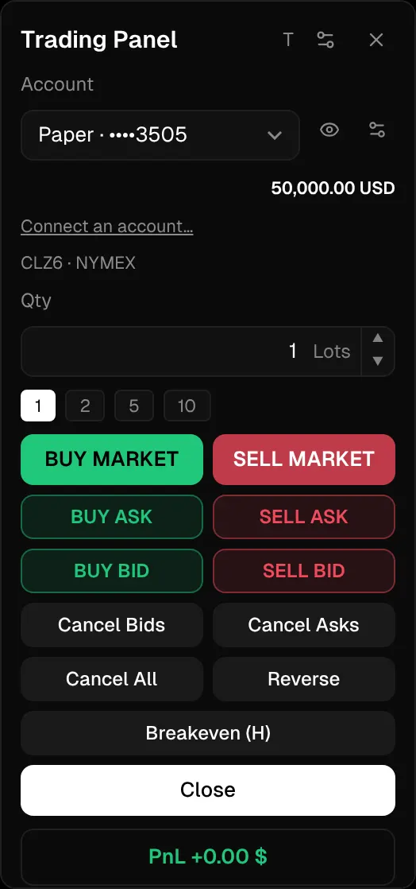
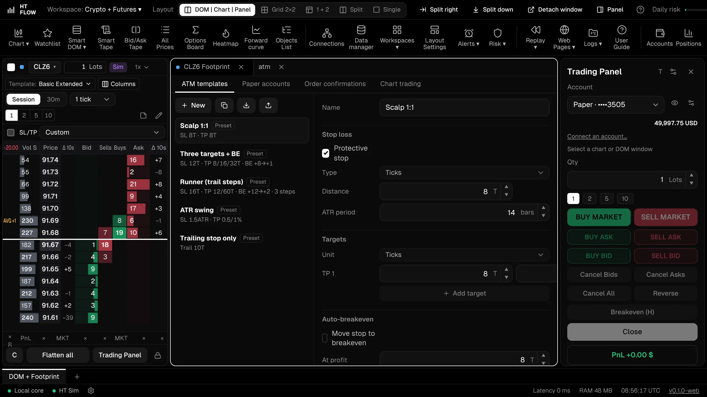
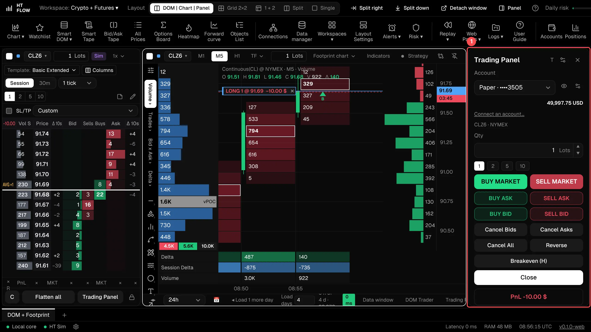
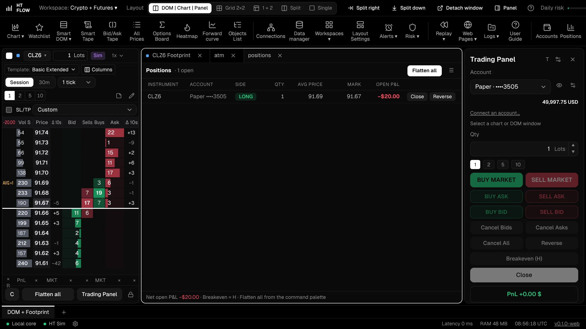
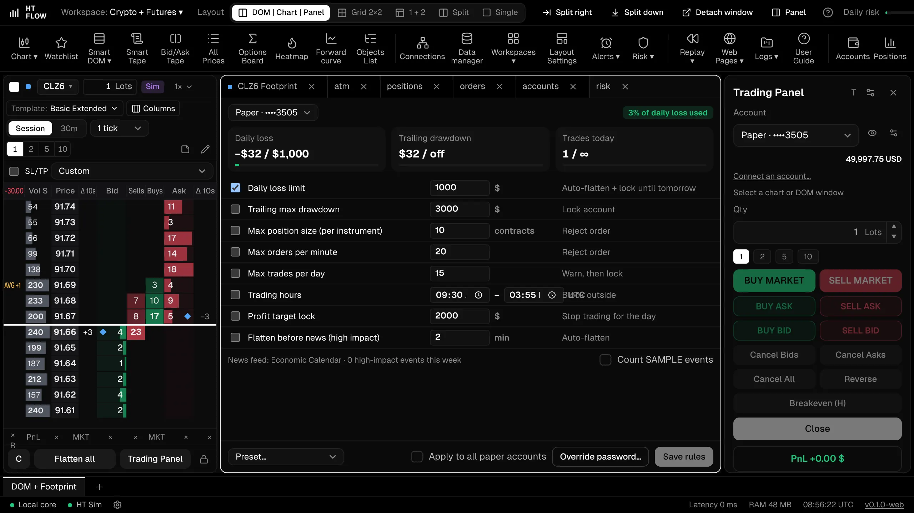
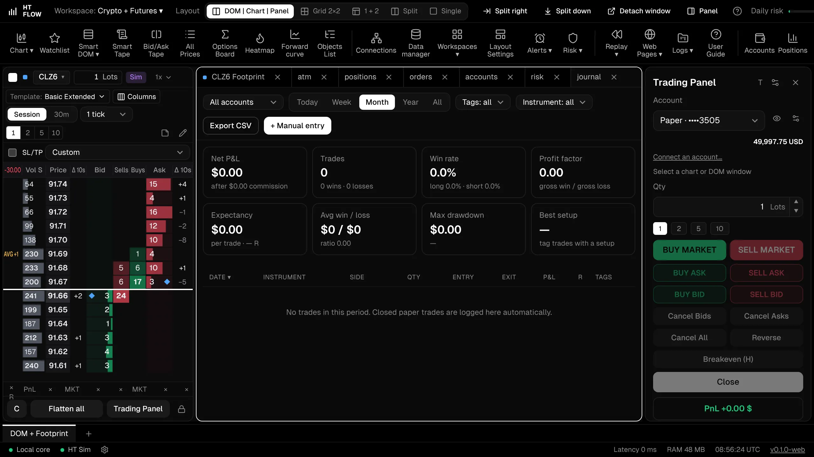
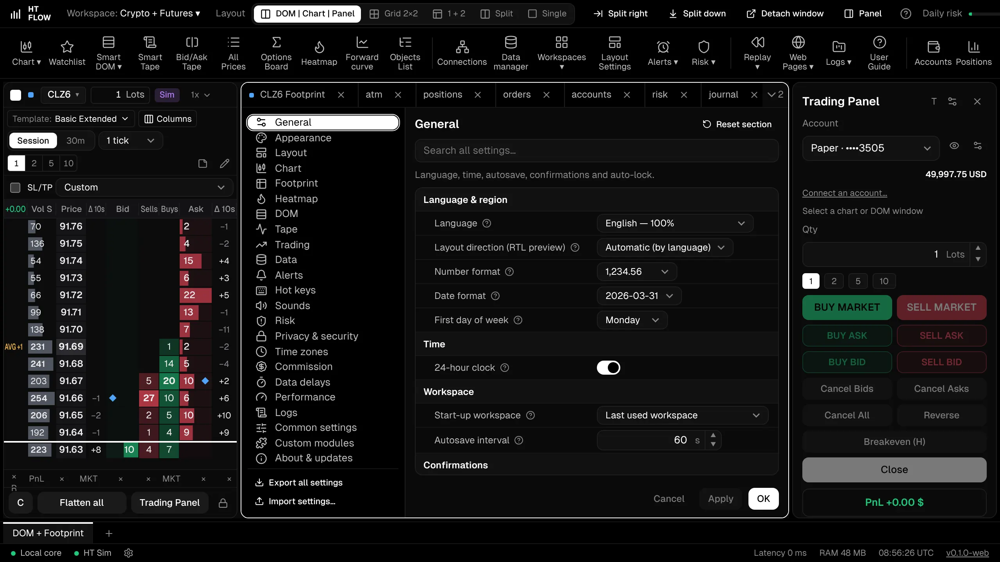

> **Note** HT Flow trades on a **paper engine** that fills against the live (or simulated) order book. There are no broker connectors yet, so no real orders are ever sent.

## Paper accounts

The default account **Paper · ••••3505** starts with 50,000 USD. Use `Paper accounts…` (command) to create, rename, set the starting balance and currency, reset or delete accounts; `New paper account`, `Reset active paper account` and `Switch to next paper account` are commands too. Account numbers can be masked (Settings → Privacy & security).

Open positions, working orders (including OCO groups, brackets and ATM management) and balances are saved in your encrypted profile and restored after a restart. Fills and trade history are not saved with the account state yet.

## The Trading Panel

Toggle it with `T` or the **Panel** button. From top to bottom: account selector (with a masked id and an eye toggle), quantity with lot presets (1, 2, 5, 10), **BUY MARKET / SELL MARKET**, **BUY ASK / SELL ASK** and **BUY BID / SELL BID** (limit orders at the best price), **Cancel Bids / Asks / All**, **Reverse**, **Breakeven** (`H`), **Close**, the P&L, position and average entry. Below: **OCO**, time in force (GTC, DAY, IOC, FOK, GTD), **Reduce-Only**, the **SL/TP** switch with an ATM template picker, and the order type selector.

The panel trades the instrument of the active chart or DOM.

## Order types

| Type                        | Behaviour                                                                               |
| --------------------------- | --------------------------------------------------------------------------------------- |
| **Market**                  | Walks the book level by level; partial fills at several prices; optional slippage guard |
| **Limit**                   | Rests and fills when the tape trades through its price                                  |
| **Stop**                    | Becomes a market order when the last trade reaches the stop price                       |
| **Stop-limit**              | Stop trigger, then a limit order                                                        |
| **MIT** (market if touched) | Triggers on touch of the price, then market                                             |
| **Trailing stop**           | Follows price by ticks, percent or ATR and only tightens                                |
| **Iceberg**                 | Shows a display quantity and refills it from the hidden total                           |

Time in force: **GTC**, **DAY**, **IOC**, **FOK**, **GTD**. **Reduce-only** orders can only shrink a position. Commissions (maker and taker, rebates allowed) come from Settings → Commission; slippage is per account on triggered orders.

## Brackets and ATM

Switch on **SL/TP** in the Trading Panel, DOM or DOM Trader to attach protective orders to every entry. An **ATM template** (`ATM templates…`) defines:

- A **stop loss** in ticks, dollars, percent or ATR, optionally trailing.
- Up to **eight take-profit targets**, each with its own quantity weight, in dollars, percent, points or ticks.
- **Auto-breakeven** and **trailing steps**.

Five presets are included: Scalp 1:1, Three targets + BE, Runner (trail steps), ATR swing and Trailing stop only (`ATM: use …` commands). When a target fills the stop shrinks to the remaining size; a stop fill cancels the targets. Templates export and import as JSON.

## OCO

Tick **OCO** (or run `Toggle OCO`) and resting orders you place form **one-cancels-other** groups: the first fill or cancel cancels the rest. `Start a new OCO group` begins another group; `Link the last two working orders as OCO` links existing orders. OCO groups show in the Trading Panel and the Orders table.

## DOM and chart trading

- **DOM**: left-click the Bid or Ask column = **buy limit** at that price; right-click = **sell limit**; hold `Ctrl` for stops. Click your order in the Orders column to cancel it, or drag it to another price to modify it. Footer: reverse, cancel all / bids / asks, **MKT** buy and sell, **Flatten all**, Trading Panel, and a **lock** that blocks every order from that DOM. (Settings → DOM → _Swap left / right click_ reverses the buttons.)
- **Chart**: right-click → **Buy Limit / Sell Stop** or **Sell Limit / Buy Stop** at the cursor price (with the panel's ATM and confirmations). Turn on `Toggle trading on chart` to show your **position line** (live P&L, ✕ to close), draggable **order and SL / TP lines**, and B / S **fill markers**.
- Per-order **confirmations** (`Order confirmations…`) and _Confirm Flatten all_ are in Settings → General.

## Positions, orders and tables

Ribbon tables (Accounts, Positions, Orders, Trades, Trading Activity) share one virtualised grid: column chooser, sort, per-column filters (text and `>` / `<=` / `=`), grouping, saved views, **CSV** and **XLSX** export. In **Orders** double-click Price or Qty (or **Modify**) to edit; Enter applies. **Positions** has Close, Reverse and **Flatten all**. **Trading Activity** logs fills, cancels, rejections, locks, risk warnings and alert firings for 90 days.

## Risk limits

The **Risk** window and Settings → Risk set per-account protection:

- Max daily loss, trailing drawdown, profit target.
- Max position size, max order size, orders per minute, trades per day.
- Trading hours with a time zone; a price collar.
- At 80 % of a limit you get a warning (the title-bar **Daily risk** meter turns amber, then red). On breach HT Flow can flatten and **lock** trading until the next day; locks survive a restart. An override password (stored hashed) can unlock.
- Presets for prop-firm style and conservative profiles; _Apply to all accounts_; a **news-flatten** option fed by the Economic Calendar.

## Trading journal

Every closed round trip is journaled: R multiple, expectancy, long / short win rate, max drawdown, best setup, equity curve with drawdown, a calendar heatmap, MAE / MFE, plus your own tags, notes, ratings and image attachments. Chart snapshots can be captured at entry and exit. Backtest trades can be imported with the tag `backtest`. Export to CSV.

## Hot keys

| Key      | Action                          |
| -------- | ------------------------------- |
| `T`      | Show / hide the Trading Panel   |
| `H`      | Breakeven                       |
| `Ctrl+L` | Lock HT Flow                    |
| `C`      | Re-centre the DOM (DOM focused) |

Order commands (Buy market, Sell market, Close position, Reverse, Cancel all, Cancel last) exist in the Command Palette without a default key so you can bind your own in Settings → Hot keys. Hot keys have **scopes** (global, chart, trading panel, replay) so a key can mean different things in different windows. The full list is in [Keyboard shortcuts](16-keyboard-shortcuts.md).

