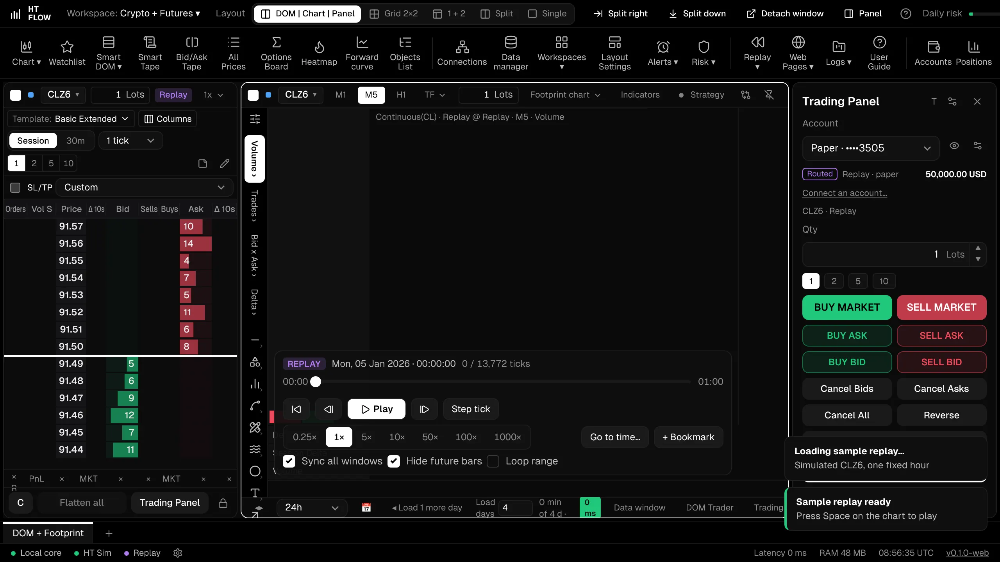
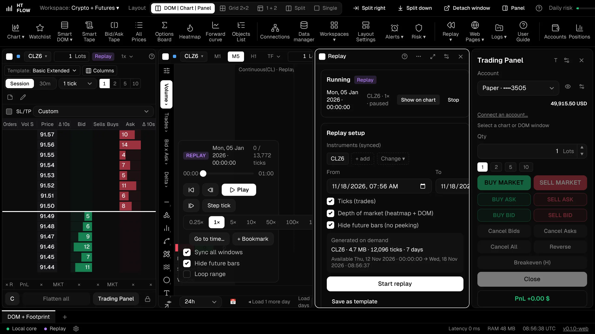

Replay plays recorded or simulated order flow on **one clock**, so charts, DOM and tape never show anything after the replay time. It is the safe way to practise: you trade on a separate replay paper account and fills are stamped with replay time.

## Quick demo

Run the command **Load sample replay session**. It replays a fixed, seeded hour of the simulated CLZ6 contract, identical every time, and opens the controls.

## Set up your own replay

1. Open **Replay** from the ribbon. It opens in its own split.
2. Add one or more **instruments** (they play in sync) and choose a **time range**. Sources are the local tick store, imported CSV data ("Imported files") and the simulator.
3. Press **Start**. Charts using the replay feed get a purple **Replay** badge.
4. Optionally save the setup as a **replay template** (bookmarks and loop are saved with it).

## Controls

| Control          | What it does                                         |
| ---------------- | ---------------------------------------------------- |
| `Space`          | Play / pause                                         |
| `Right` / `Left` | Step one bar forward / back                          |
| `Shift+Right`    | Step one tick                                        |
| `1` – `9`        | Speed presets (0.25× up to 1000×)                    |
| Timeline         | Drag to jump; economic-event markers are shown on it |
| **Go to time**   | Jump to a timestamp                                  |
| **Bookmarks**    | Save and return to moments                           |
| **Loop**         | Repeat a range                                       |
| **Sync**         | Keep several instruments on the same time            |

The keys work when the replay controls have focus (scope _replay_).

## Hide future bars

Turn on **Hide future bars** to see the chart only up to the replay time, with ghost candles for the forming bar. Future data is never fed into the store, so indicators cannot peek.

## Trading in replay

Orders go to the **replay paper account** (the account picker shows which account is routed). Entries and exits show **B / S tags** on the chart, stamped with replay time. Brackets, ATM templates and the DOM behave exactly like live paper trading. Stop and flatten before leaving replay if you do not want an open position in the journal.

## Replay for strategies

Backtests run on replay datasets too; see [Strategies and backtesting](11-strategies-backtesting.md). Missing-data download is not available yet: record data with the tick recorder or import a CSV ([Data manager](14-data-manager.md)).
