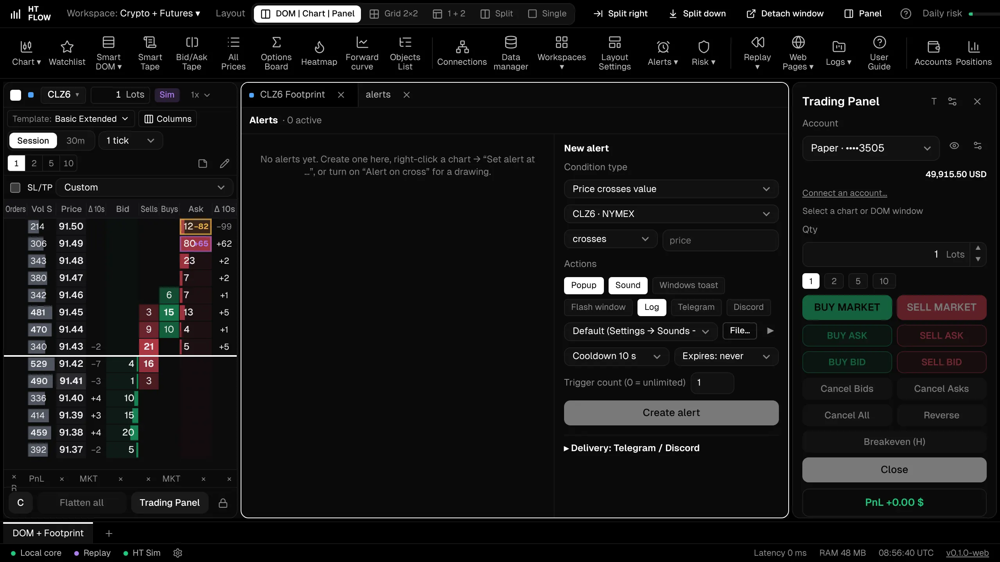
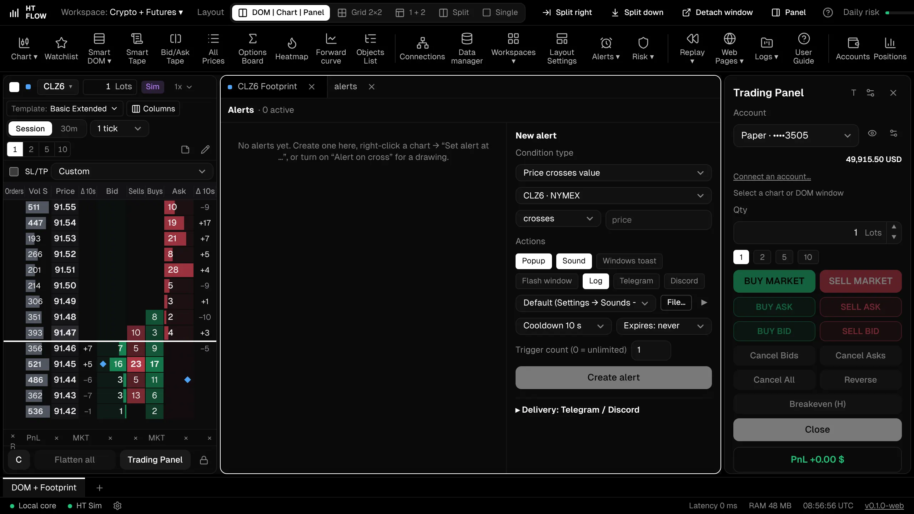
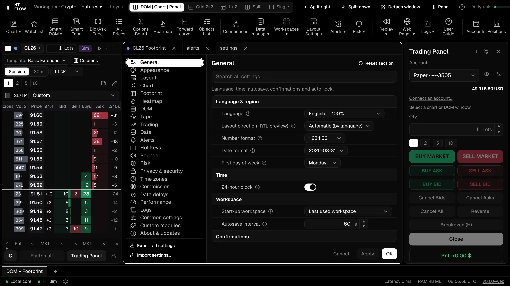

## The Alerts window

Open **Alerts** from the ribbon. Each row is one alert with its condition, instrument, state and last trigger. The ▾ menu and the commands `Alerts: Pause / resume all`, `Enable all`, `Disable all` act on all rows at once.

## Create an alert

1. Click **New alert** (or right-click a chart → **Set alert**, or the bell on a drawing).
2. Choose the **condition**:
   - **Price cross** (up, down or either) at a level.
   - **Big trade** at or above a size.
   - **Bar delta** beyond a value.
   - **DOM level** within N ticks of price.
   - **Funding rate** and **Liquidation** conditions on crypto perps.
   - **Connection lost** on a feed.
   - **Indicator value** (from the Indicators dialog's Alerts tab).
   - **Drawing** alerts: cross, enter or exit for lines, rays, channels and rectangles.
3. Set how it repeats: **count**, **expiry** and **cool-down** (defaults in Settings → Alerts).
4. Choose how you are notified, then save.

## Notifications

- A **pop-up** toast, a **beep** (built-in sound or a local file saved in your profile), a **desktop notification**, an entry in **Trading Activity**, and a flashing **window / taskbar** icon.
- **Telegram** and **Discord**: provide your own bot token or webhook; it is stored in your encrypted vault. Use _Send a test to Telegram / Discord_ to check it. Messages are throttled.
- Alert lines show on the chart at their price.

> **Note** Alerts run while HT Flow is open. They do not work when the application is closed, and a locked app still evaluates them.

## Limits and tips

- The maximum number of active alerts is set in Settings → Alerts.
- **Once per bar** currently behaves like _Every time_; use cool-down to avoid repeats.
- Sounds can be muted globally with the command `Mute / unmute all sounds`.
