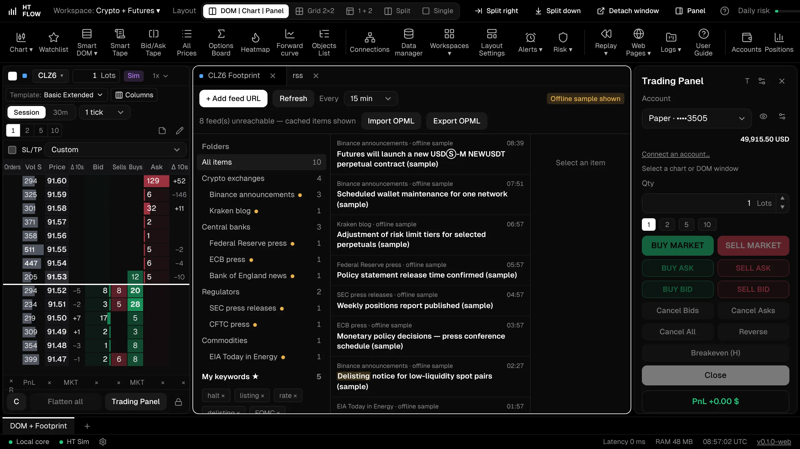
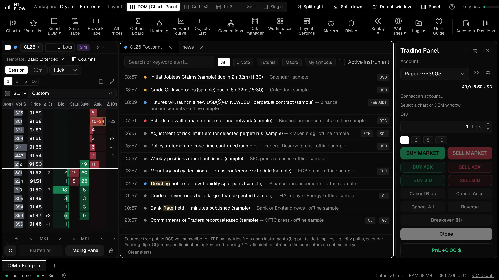
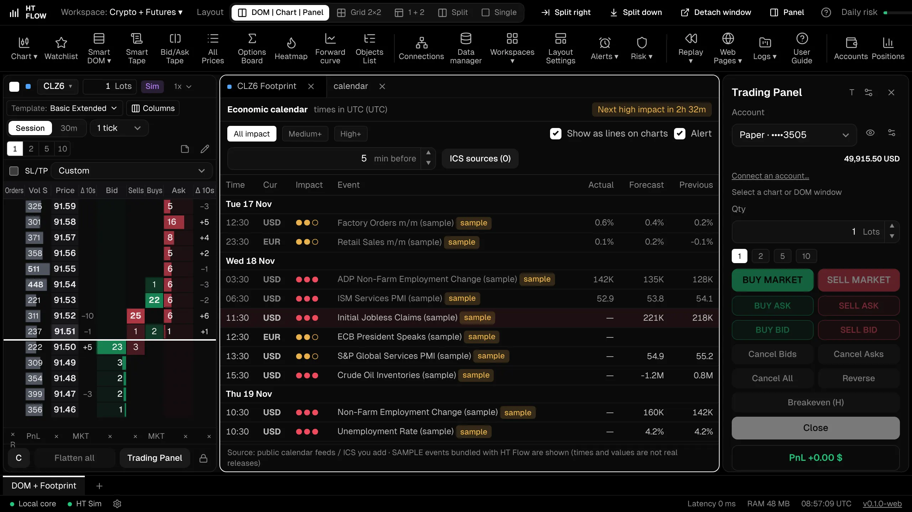
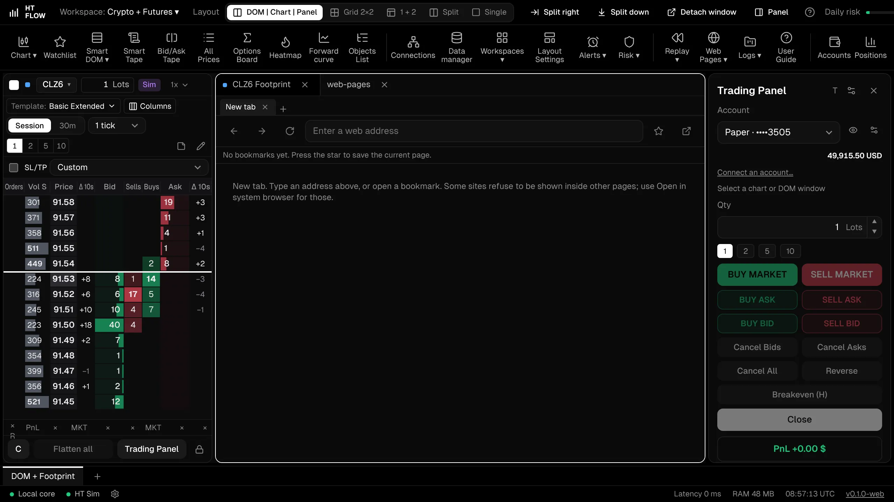

All three windows use free public sources and cache what they download, so they still show the last data offline. Feed URLs fetch through the HT Flow core (GET, 15 s timeout, 5 MB cap, no cookies); redirects to local-network addresses are refused.

## RSS Reader

- Add feeds into **folders**, see **unread** counts, read in the reading pane and open the link.
- **OPML** import and export moves your subscription list.
- **Keywords** are highlighted in headlines; symbols found in text are tagged, and a click opens that instrument's chart.
- Set the refresh interval. Links open in **Web Pages** when it is open, otherwise in your system browser.

> **Note** The default feed URLs are examples and may need replacing with feeds you trust.

## News

A combined stream of your RSS feeds, **own events** detected from your market data (big prints, delta spikes, liquidity pulls) and calendar events. Filter by source, instrument and keyword; keyword alerts notify you.

## Economic Calendar

- Filter by **impact** (low, medium, high) and country; a **countdown** shows time to the next event.
- Add **ICS** calendar URLs. Results show **actual vs forecast** colours.
- **Vertical lines** mark events on charts; an alert can fire N minutes before an event. Bundled sample data is labelled **SAMPLE**.
- High-impact events can drive the **news-flatten** risk rule ([Trading](06-trading.md#risk-limits)).

## Web Pages

A tabbed mini browser with back, forward, reload, an address bar and bookmarks (star) saved with your profile. In the browser preview pages appear in a frame, and sites that refuse framing need **Open in system browser**. In the desktop app links open in your system browser until a native child web view is added.
