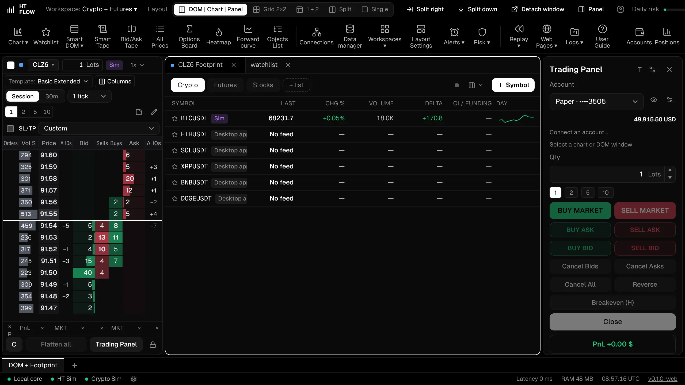
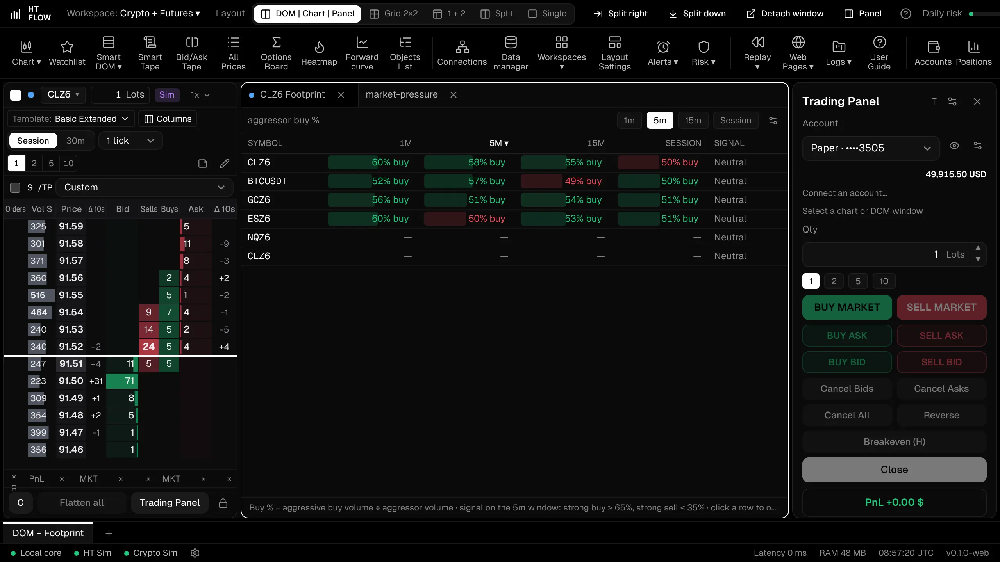
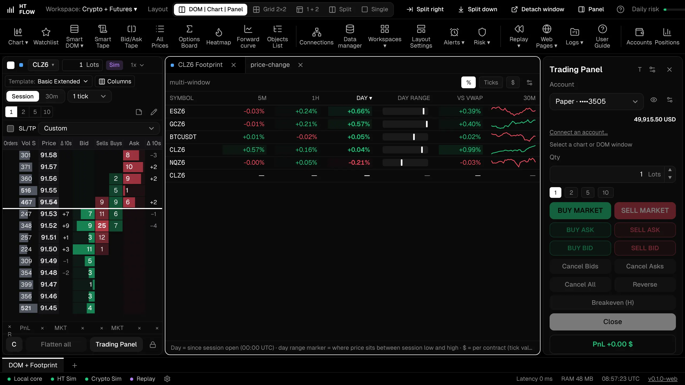
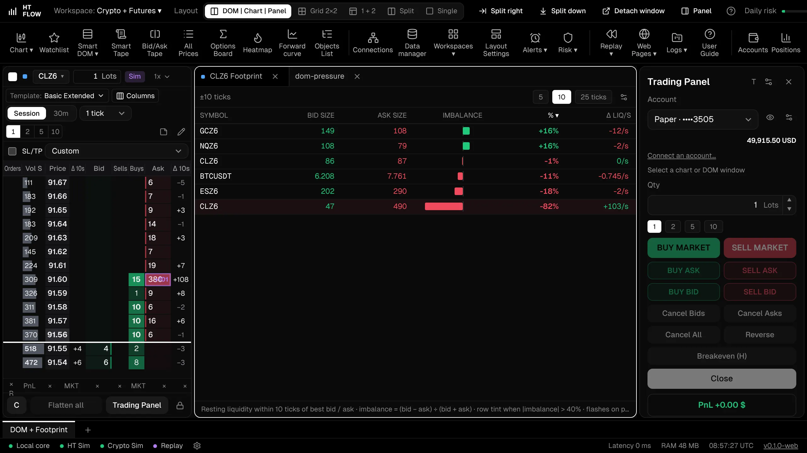
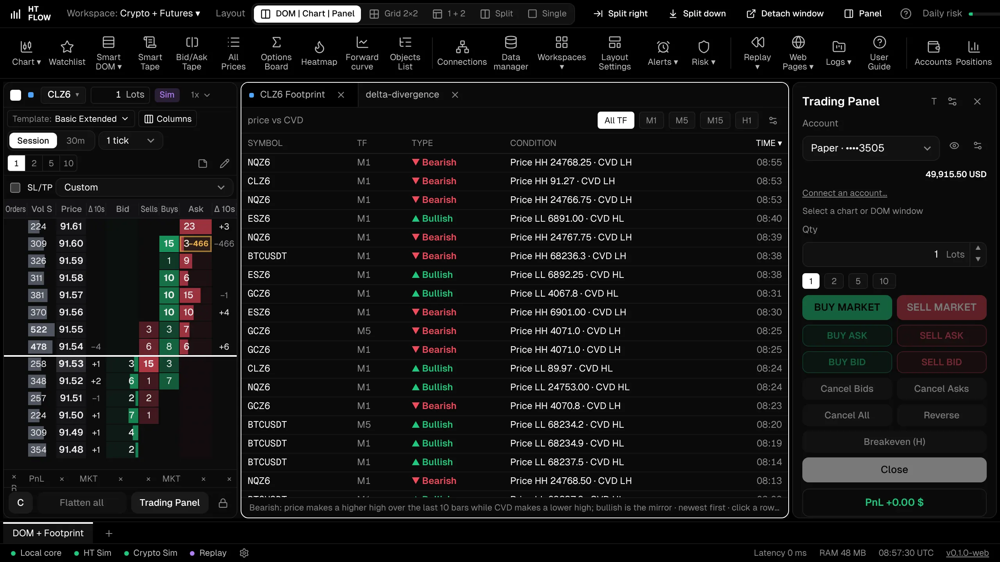
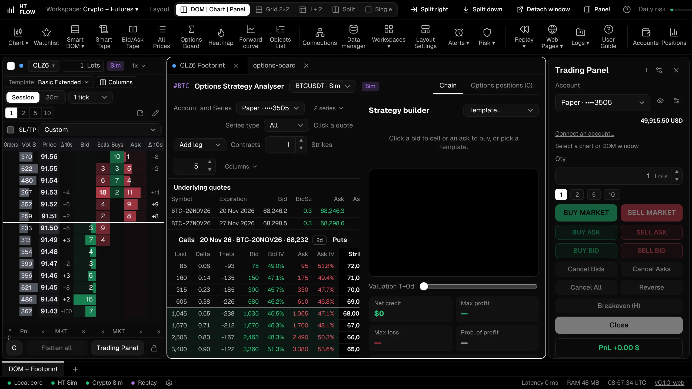
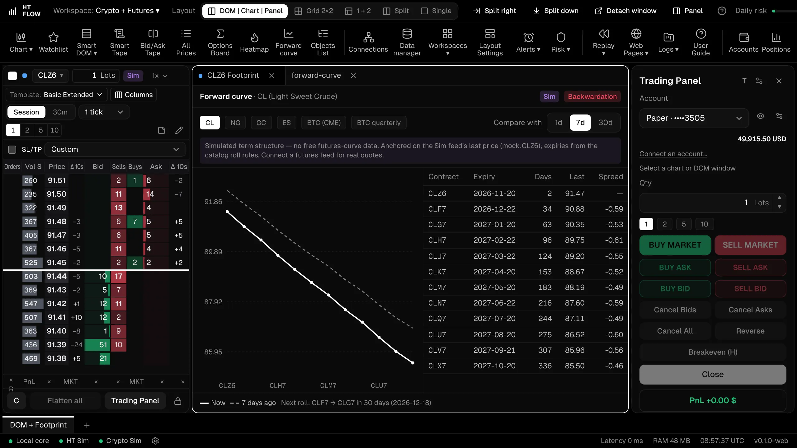

## Watchlists

- **Tabs** hold your lists; add symbols from the instrument picker.
- Columns: Last (flashes on change), Chg %, Volume, Delta, sparkline, and **OI / Funding** for crypto perps (shows "—" when a venue does not publish it). Choose columns, sort, and drag to reorder.
- Right-click a row to open a **Chart, DOM, Heatmap or Tape** for it; the link-group colour sets which windows follow when you select a row.
- Live feeds are kept only for rows you can see.

## Market scanners

Four compact dashboards watch many instruments at once (up to 200, refreshed every second). Each has a settings menu for thresholds, can show a toast and beep, and clicking a row sets the active chart.

| Window               | What it ranks                                                                           |
| -------------------- | --------------------------------------------------------------------------------------- |
| **Market Pressure**  | Buy % of volume over 1 m, 5 m, 15 m and the session                                     |
| **Price Change**     | Change in %, ticks or dollars, position in the day range, distance from VWAP, sparkline |
| **DOM Pressure**     | Bid / ask imbalance within ±5, ±10 and ±25 ticks, with pull flashes                     |
| **Delta Divergence** | Price highs / lows that disagree with cumulative delta on M1 to H1, optional absorption |

> **Note** Scanner windows only see instruments that have a feed (simulated or connected). The session starts at 00:00 UTC, and they are not linked to the Alerts module yet.

## Options Board and forward curve

The **Options Board** shows chains with series filters, expiry blocks (calls, strike with IV, puts, in-the-money tint, spot line). Click a bid to sell or an ask to buy. The **strategy builder** has 13 templates, a payoff chart at expiry and at T+n with a slider, breakevens, max profit and loss, probability of profit and total Greeks. **Send as paper order** books every leg in the paper engine; options then appear in Positions with a model mark, P&L and days left, and settle at intrinsic value at expiry. Chains for simulated instruments are generated; Deribit options come from its public data.

The **Forward curve** window shows the term structure for CL, NG, GC, ES and BTC, compares today with 1 / 7 / 30 days ago, labels contango or backwardation, and lists calendar spreads, basis and the next roll. Prices are simulated (badge **Sim**) until a futures feed is connected.
