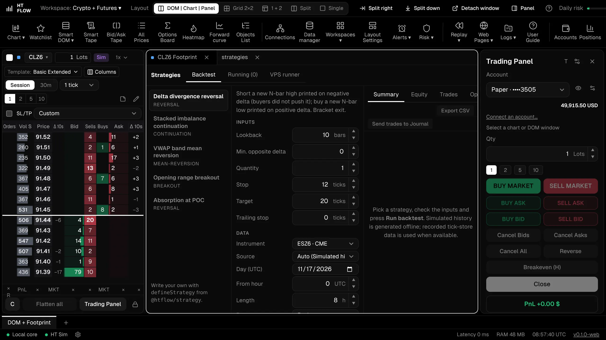
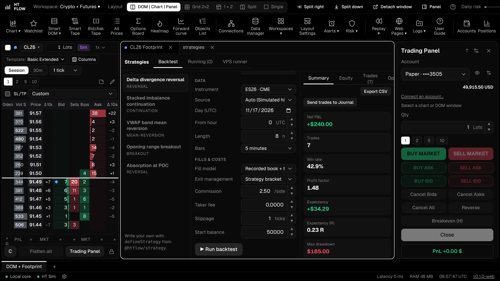

## Strategies window

Open **Strategies** from the ribbon. Five example strategies ship with the app, built on the `@htflow/strategy` SDK: typed inputs, handlers for bars, trades, book updates and fills, indicator access, footprint helpers and an order API with brackets, trailing stops and ATM templates.

1. Pick a **strategy** and set its **inputs**.
2. Choose the **dataset** (a replay source: simulator, tick store or imported CSV) and a date range.
3. Set **slippage** and **commission**.
4. Press **Run backtest** (`Strategies: Run backtest`).

The backtester is deterministic: the same inputs and data always give the same trades.

## Reading results

Summary statistics (net profit, win rate, profit factor, max drawdown, Sharpe, Sortino, Monte-Carlo drawdown), the trades list, an equity curve and a log. **Export results to CSV** and **Send backtest trades to Journal** (tagged `backtest`) are buttons and commands.

## Optimise

`Optimise inputs (grid search)` runs every combination of the ranges you give in a Web Worker, shows a **heatmap** of results and supports **walk-forward** testing (optimise on one window, test on the next) to avoid fitting noise.

> **Tip** A handful of trades proves little. Prefer parameter regions where neighbours also work over a single best cell.

## Run on a chart (paper)

`Chart: Attach strategy…` puts a strategy on a chart with entry / exit **markers**; `Start / stop live strategy (paper)` trades it on the paper engine. `Strategies: Show running strategies` lists them and `Stop all and flatten` is the emergency button.

## VPS runner

You can run a built-in strategy on **your own** VPS (no HT Flow server): add a VPS (host, port, user and SSH key or password stored in the vault; the host key is pinned on first use), run the system check (Node.js 22+), **deploy** a strategy as a single-file Node.js bundle, then start, stop, restart or remove it. The window polls uptime, P&L, position, trades and log lines, offers a remote console, and imports fills into the Journal as the "VPS" account. Live order routing is not available yet (it needs a broker connector).

## Not available yet

A code editor for strategies, `.ts` / `.py` / `.htstrat` loading, a Python runner and a no-code rule builder. Indicators can already be scripted ([Charts](04-charts.md#indicators)).
