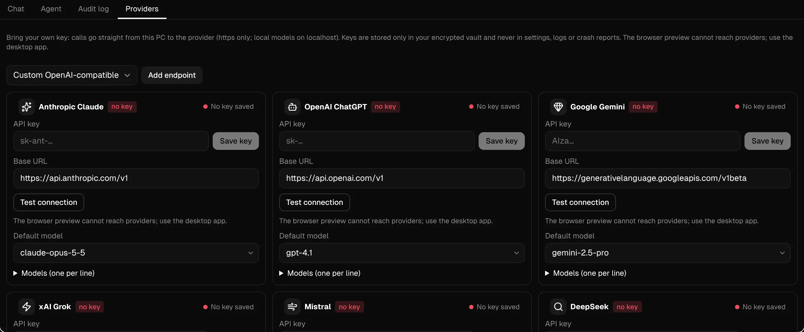
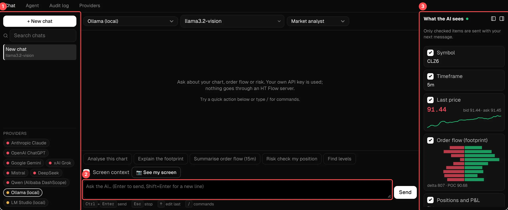
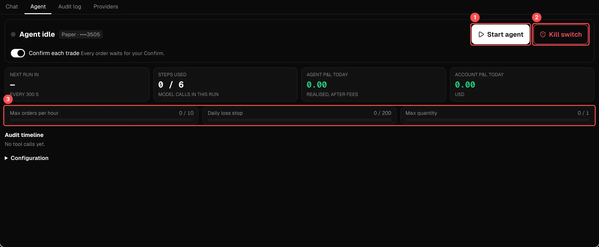
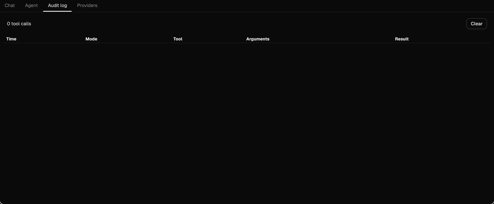

> **New** The AI page is new in this release.

The AI page is an assistant for your charts, order flow and risk. It follows HT Flow's rules: **there is no HT Flow server and no subscription**. You bring your own API key (or run a local model), calls go straight from your PC to the provider you chose, and keys are kept only in your encrypted vault, never in settings, logs or crash reports.

Open it from the ribbon (**AI**), with `Ctrl+K` → `AI: Open assistant`, or with `AI: Ask about this chart`. It has four tabs: **Chat**, **Agent**, **Audit log** and **Providers**.

## Set up a provider first

1. Open the **Providers** tab. Each card is one provider: Anthropic Claude, OpenAI ChatGPT, Google Gemini, xAI Grok, Mistral, DeepSeek, Qwen, or a local model (Ollama, LM Studio) or your own endpoint (**Add endpoint**).
2. Paste your **API key** and press **Save key**. Local models on `localhost` need no key.
3. Press **Fetch model list** to load the models you can use, then **Test connection**. The status chip reads _Ready_, _Unreachable_, _No key saved_ or _Not tested_.

Only `https` addresses are accepted (plus `localhost` for local models), and each provider's base URL is checked against an allow-list.

> **Note** The browser preview cannot reach providers. Use the desktop app.

## Chat

1. **Conversation list** on the left: new chat, search, rename, pin and delete. Provider chips at the bottom show which providers are ready.
2. **Composer**: type a question and press `Ctrl+Enter` (or **Send**). `Esc` stops a reply, `↑` edits your last message, and typing `/` lists commands. You can also drop or paste an image (PNG, JPEG or WebP up to 5 MB).
3. **What the AI sees** (right): the symbol, timeframe, last price, a footprint snapshot, indicators, positions, P&L and working orders. **Only the items you leave checked are sent** with your next message.

**Quick actions** and slash commands start common requests: `/analyse`, `/footprint`, `/flow` (last 15 minutes of order flow), `/levels`, `/risk` and `/screenshot`. The same actions are in the Command Palette (`AI: Analyse this chart`, `AI: Explain the footprint`, …).

Answers are more than text:

- **Price chips**: a price in an answer is clickable. Draw a line on the chart or **Set alert here**.
- **Order cards**: when the AI suggests a trade you see entry, stop-loss, take-profit, risk, reward and reward / risk, with warnings such as "No stop-loss: risk is unbounded". Nothing is sent until you press **Confirm** (or **Edit** / **Reject**). Orders go to your paper account.
- **Tool steps**: in chat the AI may call read-only tools (market data, footprint stats, positions, account, orders). You see each call and its result.

### Screenshots and privacy

**See my screen** attaches a picture of the HT Flow window only; other apps are never captured. Settings → Privacy & security → _Send screenshots to AI_ chooses **Always ask** (a confirmation shows the provider and model), **Send automatically** or **Never**. _Send screen context to AI_ switches the text summary on or off. Models that cannot read images disable the button.

## Agent

The agent runs the conversation's goal on a schedule and may place **paper** orders through the same engine and checks as your own orders. It is strictly limited:

1. **Start agent** / **Stop agent**, plus **Pause**.
2. **Kill switch**: stops the agent at once and blocks every AI order until you reset it.
3. **Hard limits** with live gauges: maximum quantity per order, orders per hour, a daily loss stop and an optional list of allowed symbols. They are enforced as pre-trade checks, and the account's Risk rules still apply.

**Confirm each trade** (on by default) makes every agent order wait for your approval. Under **Configuration** you set the account, the run interval, the maximum steps per run and the goal. Paper accounts never need arming. The **Audit timeline** lists every tool call.

> **Warning** The agent is a helper, not advice. Start with small limits and keep _Confirm each trade_ on. Model answers can be wrong.

## Audit log

Every tool call of chat and agent is logged with time, mode, tool, arguments and result. Failed calls are highlighted. **Clear** empties the list.

## Commands and settings

| Where                                           | What                                                                |
| ----------------------------------------------- | ------------------------------------------------------------------- |
| `AI: New chat`, `AI: Regenerate reply`          | Conversation                                                        |
| `AI: Start agent`, `Stop agent`, `Pause agent`  | Agent control                                                       |
| `AI: Kill switch (stop agent, block AI orders)` | Emergency stop                                                      |
| Settings → Common → _AI assistant_              | Show or hide the AI button in window headers                        |
| Settings → Privacy & security                   | Screenshots, screen context, whether chat may read market data      |

If the AI button is missing from your window headers, check the first setting above.
