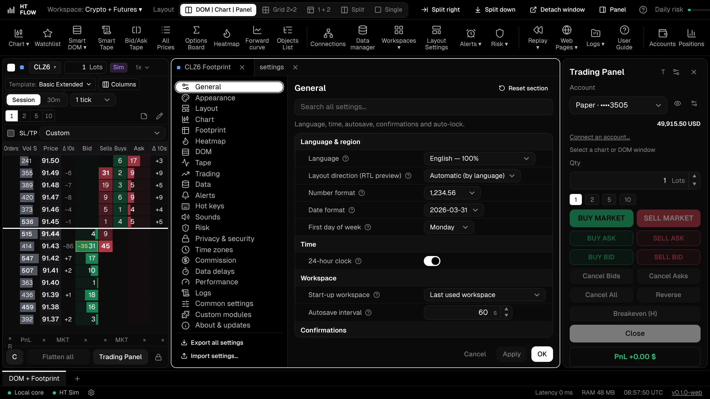
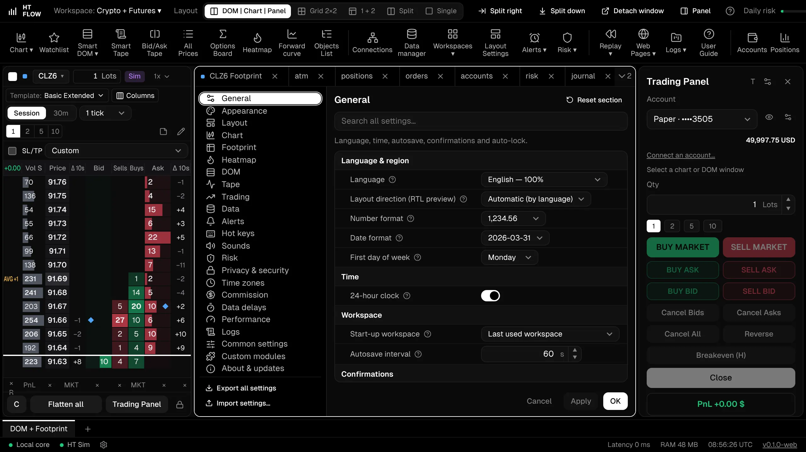
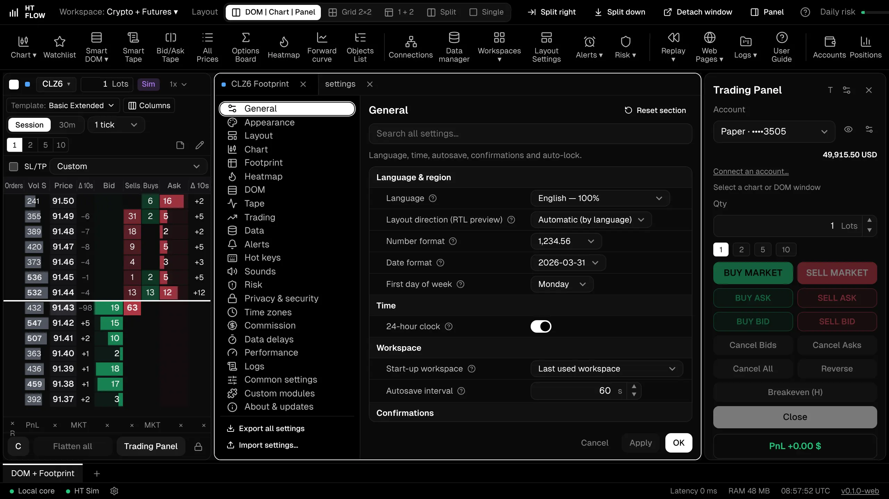
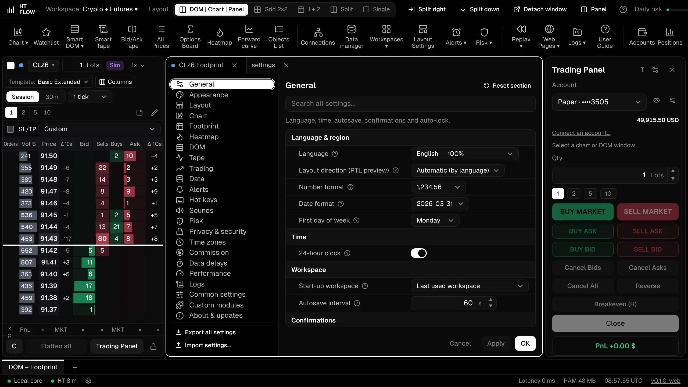

Open Settings with `Ctrl+,` or `Ctrl+K` → `Settings: <section>`. Search finds any setting by name. Changes are held as a **draft** until you press **Apply** or **OK**; **Cancel** drops them. Modified settings are marked, and each can be reset on its own, per section or all at once. Settings are saved per user (encrypted) and can be exported and imported as JSON with per-key validation. Palette search also finds individual settings.

| Section                | What it controls                                                                                                                                                                              |
| ---------------------- | --------------------------------------------------------------------------------------------------------------------------------------------------------------------------------------------- |
| **General**            | Language and region (number and date format, first day of week), 24-hour clock, start-up workspace, autosave interval, confirmations (orders, Flatten all, closing a window, exit), auto-lock |
| **Appearance**         | Theme, 29-token colour editor, UI scale, font size, icons-only ribbon                                                                                                                         |
| **Layout**             | Snap to grid, gaps, lock layout, header density and style, layout tabs position, where new windows open, link-group colours, multi-monitor restore                                            |
| **Chart**              | Default mode and timeframe, auto-scroll, candle colours, background, grid, axes and scale, crosshair, legend and status line                                                                  |
| **Footprint**          | Cell content, colouring, font and cell size, imbalance ratio and colours, POC and value area, summary rows                                                                                    |
| **Heatmap**            | Palette, contrast, normalisation, minimum order size, history depth, overlays, bubbles                                                                                                        |
| **DOM**                | Row height, font, auto-centre, default grouping, big-lot threshold, swap click buttons                                                                                                        |
| **Tape**               | Rows kept, minimum size, follow new trades, milliseconds, big-trade threshold, beep                                                                                                           |
| **Trading**            | Default quantity, presets, order type, time in force, one-click, hot keys, slippage tolerance, automatic SL / TP, order and position lines                                                    |
| **Data**               | Provider priority, auto-reconnect and back-off, timestamp source, depth conflation, record live ticks, cache size                                                                             |
| **Alerts**             | Enabled, pop-up, window flash, default repeat, expiry, cool-down, maximum active                                                                                                              |
| **Risk**               | Daily loss, position and order size, trades per day, price collar, warning level, breach action, lock duration                                                                                |
| **Hot keys**           | Record a key per command, conflicts, scopes, presets, export / import                                                                                                                         |
| **Sounds**             | Mute, master volume, seven event sounds, your own `.wav` / `.mp3`                                                                                                                             |
| **Time zones**         | Application, chart axis and calendar time zones, exchange clocks and hover time                                                                                                               |
| **Commission**         | Crypto maker and taker fees, futures round-turn commission, rules by account and instrument                                                                                                   |
| **Data delays**        | Latency thresholds for amber / red status pills                                                                                                                                               |
| **Performance**        | Renderer, video adapter, FPS cap, worker threads, debug overlay, hidden-window rendering                                                                                                      |
| **Common settings**    | Value area percent, maximum candles per chart, default load days, recorder disk budget and retention, notifications, tables                                                                   |
| **Privacy & security** | Telemetry (off), crash reports, mask account numbers, hide balances, clear caches on log-out, reset everything                                                                                |
| **Logs**               | Log level and in-memory entries                                                                                                                                                               |
| **Custom modules**     | Enable or disable windows                                                                                                                                                                     |
| **About & updates**    | Version, update check and channel (Stable or Beta)                                                                                                                                  |

> **Note** A few options are shown but not active yet (they are marked in the window): MBO history storage and the NTP server. They are placeholders for work that needs the native core.

