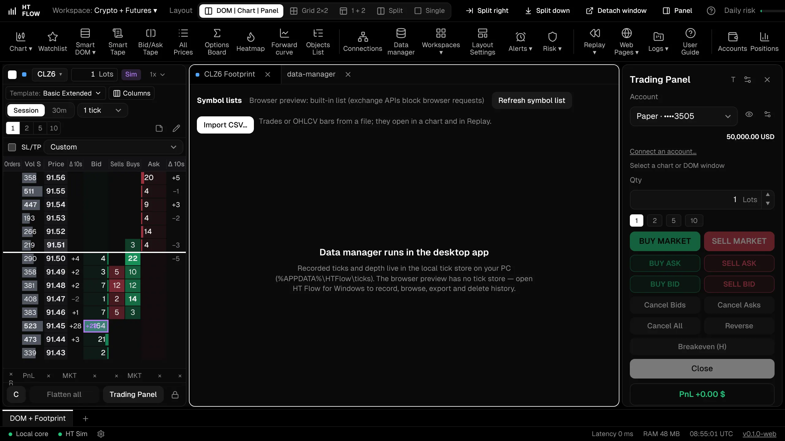
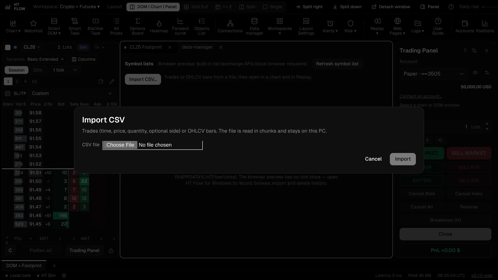

## Data manager

Open **Data manager** from the ribbon or the Connections window's second tab. In the desktop app it shows the **local tick store** (`%APPDATA%\HTFlow\ticks`, or `data\ticks` in portable mode):

- Every stored instrument with its date range and per-day sizes.
- **Delete** an instrument or a single day; **export** trades or depth to CSV.
- **Recorder**: tick recording of the instruments you subscribe to on or off, with **retention days** and **max disk GB**. Old days are compacted and removed when either limit is reached.
- Imported files ("Imported files") and your symbol lists.

The store keeps one set of files per instrument and UTC day, compressed in checksummed blocks. A torn write after a crash is ignored and the index is rebuilt. The browser preview has no tick store.

## Import CSV

Run `Import CSV: trades or OHLCV bars…` (Data manager or Connections → CSV / Parquet import):

1. Choose the file. The delimiter, header, columns and time format (epoch s / ms / µs / ns, ISO, d/m/y text) are detected; correct them if needed.
2. Pick the **time zone** and the **side semantics** (including `is_buyer_maker`).
3. Check the preview of the first rows, with per-row validation. Rejected rows are listed with line numbers.
4. **Import**. Large files are streamed in chunks.

The data becomes a `csv:<name>` instrument that opens in charts and in Replay. OHLCV bars become four synthetic trades each, so footprints from bar data are approximations. Parquet and depth CSV are not supported yet.

## What you can export

| What                                                  | Where                                           | Format                                           |
| ----------------------------------------------------- | ----------------------------------------------- | ------------------------------------------------ |
| Profile (account, settings, workspaces)               | Account menu → Export profile                   | `.htprofile`, still encrypted with your password |
| Workspace                                             | Workspaces manager, `Workspace: Export current` | `.htworkspace`                                   |
| Chart template                                        | Template menu, `Chart: Export template JSON`    | `.httemplate` / JSON                             |
| Chart data                                            | Chart right-click → Export                      | PNG, bars CSV, clusters CSV, bars JSON           |
| Tables                                                | Table ☰ menu                                   | CSV, XLSX                                        |
| Tick history                                          | Data manager                                    | CSV (trades or depth)                            |
| Indicator script                                      | Script Editor                                   | `.htind`                                         |
| ATM template, DOM template, settings, theme, hot keys | their editors                                   | JSON                                             |
| Logs                                                  | Logs window                                     | `.txt`                                           |

CSV exports neutralise spreadsheet formulas so opening them in a spreadsheet is safe.
