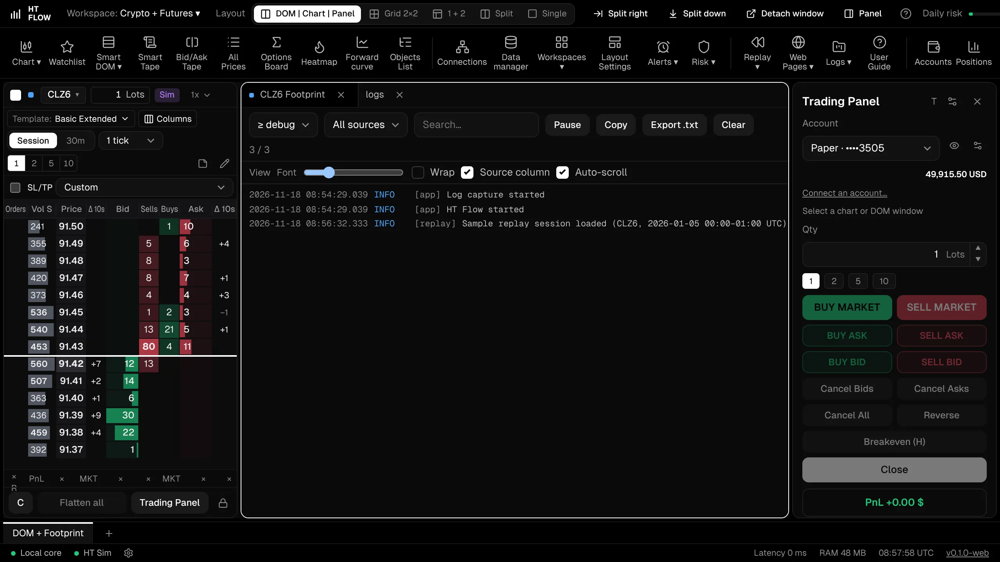

## Where your data lives

| Item                                                       | Location                                                                                |
| ---------------------------------------------------------- | --------------------------------------------------------------------------------------- |
| Profiles (settings, workspaces, journal, templates, vault) | `%APPDATA%\HTFlow\` (portable: `data\` next to the exe), sealed with XChaCha20-Poly1305 |
| Tick history                                               | `ticks\` inside the data folder                                                         |
| Crash reports                                              | `crashes\` inside the data folder; redacted, never sent anywhere                        |

## Backups

HT Flow has no cloud sync, so backups are yours to make:

1. **Account menu → Export profile (.htprofile)** writes everything of one user into a single file that stays encrypted with that user's password. Import it from the login screen on any PC.
2. **Workspaces manager → Export** and chart templates export to files you can keep in version control.
3. Copying the whole data folder while HT Flow is closed backs up every profile and the tick store.

> **Note** Automatic store backups (Settings → Common → _Backup period_, _Maximum store backups_) are shown but are not active yet.

To restore, import the `.htprofile` on the login screen, or copy the data folder back. Without the password or recovery code a profile cannot be opened.

## Logs

The **Logs** window (ribbon) is an in-app ring buffer of what HT Flow is doing, including captured `console.error` output, uncaught errors and unhandled promise rejections.

- Filter by **level** and **source**, or search the text.
- **Pause** freezes the view while recording continues. **Copy**, **Export .txt** and **Clear** act on what you see.
- Settings → Logs sets the level and how many entries are kept in memory (log files on disk are not available yet).

## Crash reports and problem reports

If HT Flow crashes, a redacted report (tokens in URLs and query values removed) is written to `crashes\`. **Report a problem…** (Help menu) collects the same kind of information so you can attach it to an issue. Nothing is uploaded automatically; telemetry is off.
